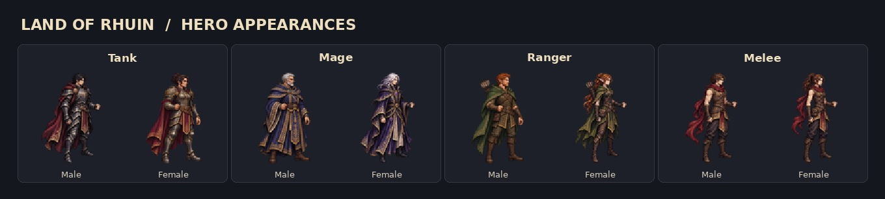
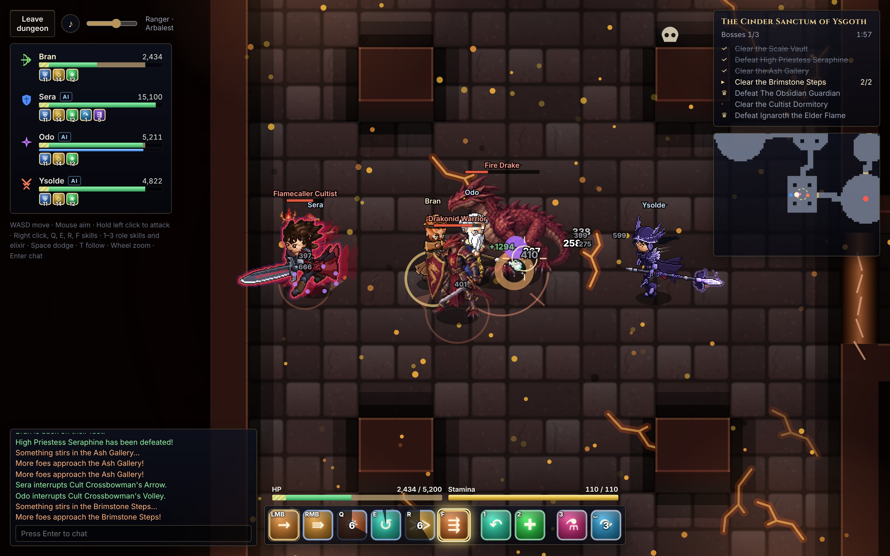
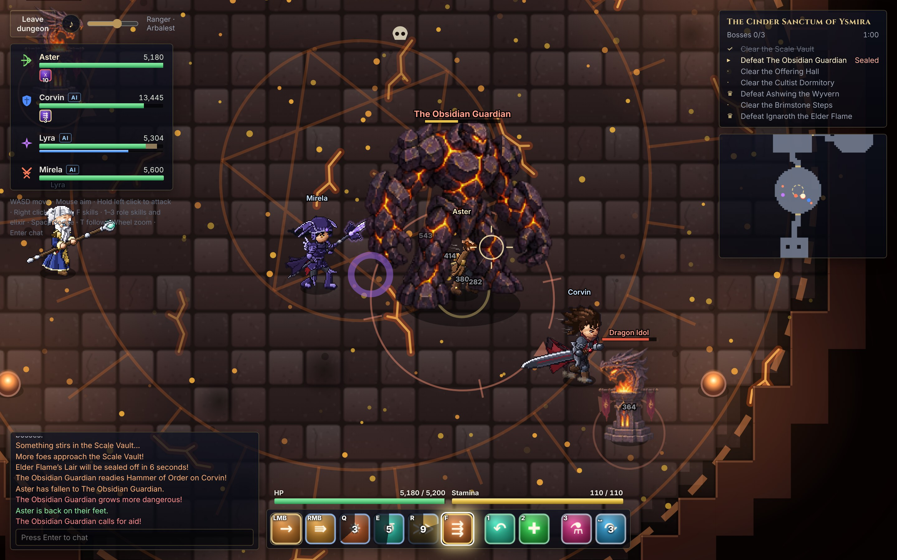
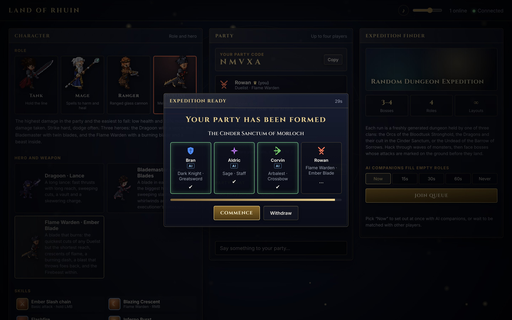

# Land of Rhuin

A four-player co-op hack-and-slash dungeon RPG that runs in the browser. Form a party of four (Warrior,
Mage, Ranger and Duelist) and carve through a dungeon generated fresh for every run. Every dungeon
belongs to one of three monster clans: **Orcs**, **Dragons and their cultists**, or the **Undead**.
Each run has waves of monsters, then 3 or 4 bosses whose attacks are marked on the ground before
they land. Players queue together or alone, and AI companions fill any role nobody is playing.

Combat is aimed and hands-on. Hold the mouse to swing your weapon's combo, fire skills toward the
cursor, and dodge-roll through danger. The dungeon structure takes its cues from big fantasy MMO
dungeons: a finder queue with a ready check, aggro and taunts, sealed boss arenas, and orange
telegraphs to step out of. Teamwork is the heart of it: monsters hit far too hard for anyone but the
Warrior to take, the Warrior needs a healer to last, and the damage dealers have to keep their
aggro under the Warrior's. All names, art, skills and bosses are original.


## Quick start

You need Node.js 20.19 or later.

```sh
npm ci
npm run build
npm start            # http://127.0.0.1:8787
```

Open the address, pick a name, choose a role and weapon, set **AI companions fill empty roles**
to **Now**, and press **Join Queue**. Accept the ready check with **Commence**.

To play with friends on your network, start the server with `npm start -- --host 0.0.0.0` and
have them open `http://<your-ip>:8787`. One player shares their **party code**; the others type
it into **Party code** and press **Join**. The party leader then joins the queue.

| Server option | Effect |
| --- | --- |
| `--port 8787` | Port for the web page and the game socket. |
| `--host 127.0.0.1` | Interface to listen on. Use `0.0.0.0` for LAN play. |
| `--quick` | Monsters have a quarter of their health. Good for trying things out. |
| `--countdown 5` | Seconds before the entrance barrier drops. |
| `--clan orc` | Make every dungeon belong to one clan: `orc`, `dragon` or `undead`. |

For development, `npm run dev` runs the server with reload on port 8787 and the Vite client on
http://localhost:5173 (it forwards the game socket to the server).

## Controls

| Input | Action |
| --- | --- |
| W A S D | Move |
| Mouse | Aim. Your hero always faces the cursor. |
| Hold left mouse | Basic attack: your weapon's three-hit combo |
| Right mouse | Weapon special |
| Q, E, R | Weapon skills |
| F | Weapon ultimate |
| 1, 2 | Role skills |
| 3 | Elixir (restores 35% HP) |
| Space | Dodge roll: a short roll during which nothing can hurt you. Costs stamina. |
| T | Follow the Warrior, or the party member you selected |
| Tab, F1 – F4 | Select an enemy or a party member to see them in the target frame |
| Mouse wheel | Zoom |
| Enter | Chat |
| M | Music on or off (the ♪ button and slider by it set the volume) |

Every skill is aimed at the cursor:

- **Arcs and thrusts** hit everything in front of you.
- **Projectiles** fly until they hit something; some pierce or explode.
- **Ground skills** land where you point, some after a short delay, shown as a blue marker.
- **Dashes and leaps** carry you through or onto your enemies.

A few heavy skills have a short wind-up; moving or rolling cancels it.

## Roles and weapons

Each role has two heroes, a man and a woman, and each hero carries one weapon of their own:
choosing your hero chooses your weapon.

| Role | Strengths | His weapon | Her weapon |
| --- | --- | --- | --- |
| **Warrior** (tank) | The only hero who can take the monsters' blows: 16,000 health and 55% damage reduction. Builds three times the aggro, holds it, and loses it three times slower. Needs a healer in a long fight. *Rallying Bulwark* gives the whole party 20% damage reduction and a barrier. | Greatsword, two-handed: the Dark Knight | Sword and shield: the Guardian, a paladin with healing light |
| **Mage** | Offensive and healing spells. | Branch staff, two-handed (the healer) | Mystic sword and a wand |
| **Ranger** | High damage from range. A glass cannon: low health, 15% more damage taken. | Crossbow | Longbow |
| **Duelist** (melee) | The highest damage in the party, and the easiest to fall: low health, 20% more damage taken. | Halberd, two-handed | Twin blades |

| Weapon | Style | Special (RMB) · Q · E · R · Ultimate (F) |
| --- | --- | --- |
| Greatsword (Warrior) | Dark Knight | Parry · Stalwart Charge (dash through foes: a 0.5s stun, a great deal of aggro, and 35% less damage taken for 5s) · Eclipse (a full circle swing that slows) · Drain (damage all around; heals you for 60% of it) · Ruination (costs 50% of your maximum health: four massive strikes rain on your aim) |
| Sword & Shield (Warrior) | Guardian | Aegis (shield up: 60% less damage) · Flash (dash through foes: a 0.5s stun, a great deal of aggro, and 35% less damage taken for 5s) · Mend (heals you for 18% and draws every foe nearby) · Shield's Up! (blocks all damage for 3s, then bursts for 30% of what it absorbed) · Luminaire (massive damage to every enemy in sight) |
| Staff | Sage (healer) | Mending Light (heal circle) · Arcane Orb · Sanctuary (healing ground) · Meteor · Resurrection |
| Mystic Sword & Wand | Spellblade | Runic Ward (barriers) · Spellblade Rush · Arc Lightning · Lifebinding Sigil (damage and heal) · Astral Cleave |
| Crossbow | Arbalist | Piercing Bolt · Explosive Bolt · Tumble Shot · Scattershot · Siege Barrage |
| Longbow | Marksman | Charged Shot · Volley · Snare Trap · Fan of Arrows · Rain of Ruin |
| Halberd | Halberdier | Sweeping Strike · Piercing Thrust · Vault Strike · Whirling Halberd · Skewer |
| Twin Blades | Reaver | Rising Slash · Whirlwind · Reaver's Lunge · Executioner · Cataclysm Blades |

Role skills: the Warrior has **Challenge** (taunt everything nearby) and **Rallying Bulwark**. The
Mage has **Arcane Blink** and **Mana Font**. The Ranger has **Vault** and **Field Dressing**. The
Duelist has **Bloodrush** (more damage dealt, more taken) and **Second Wind**.

The Staff is the party's healer. An AI companion filling the Mage slot is always the Staff-carrying
Mage. A party
without a Staff gets the *Ward of Rhuin*: 15% less damage taken and a slow heal in combat.

In AI-only test runs, Duelists deal about 1,500 damage per second, Rangers about 1,150, Mages
about 700 and Warriors 550 (Guardian) to 700 (Dark Knight).

## Aggro and teamwork

Every monster keeps its own aggro table: how much each hero has drawn its attention. It attacks
whoever tops that table.

- **Damage builds aggro**, one point per point of damage. The Warrior builds three times as much.
  Stalwart Charge and Flash build three times as much again, plus a flat 3,000. Eclipse, Drain,
  Ruination and Luminaire build half as much again.
- **Healing builds aggro** on every monster in the fight within 30 tiles of the healer: 0.6 per
  point actually healed. Overhealing does not count.
- **First contact** adds a flat 1,500 the first time a hero touches a monster, twice that for the
  Warrior, so whoever opens the fight gets its attention.
- **Unhinged damage builds aggro fast.** A hero's recent damage on a monster runs hot and cools by
  half every 2 seconds. Once it passes about 4,500, every blow counts double, rising to 3.5 times.
  A Duelist who unloads everything on one target pulls it.
- **Monsters are sticky.** To pull a monster off its target you need 10% more aggro than the
  target has, or 30% more if the target is the Warrior.
- **Aggro fades** by 3% a second, the Warrior's by 1%, so a Warrior who keeps working holds what
  they have taken. **Challenge** puts the Warrior at the top of every table within 9 tiles and
  turns those monsters on them at once.

Monsters hit hard. Blows aimed at their aggro target (routine swings and a boss's routine
attacks, heavy cleaves, bolts and arrows) deal three times the damage they used to, and tank
busters about 65% more. Wide area attacks and the other boss mechanics are unchanged. Monsters
have 80% more health than before and bosses 30% more, so fights last long enough for aggro to
matter.

What that means in a fight:

- With a pack of three on them, a Duelist, Ranger or Mage falls in 3 to 7 seconds, whether they
  fight back or not.
- A Warrior lasts far longer: about 12 seconds standing still, and much longer fighting.
- Alone against five monsters, the Dark Knight falls in about 20 seconds and the Guardian in about
  40. With the Staff healer behind them, both win.

Reading aggro on screen:

- **The target frame** lists the top four on your target's table as a share of the top, with
  your own row marked.
- **Over a monster's name:** a pulsing red **!** means it is coming for you. If you are the
  Warrior, a gold **◆** marks the ones on you and an orange **◇** the ones loose on the party.
- **By the hotbar:** "Pulling aggro: 90% of the tank — ease off" when you are close to pulling a
  monster off the Warrior; "You have aggro! … get to the tank" when something has come for you.
  The Warrior sees "2 loose on the party — grab them!".

AI companions play by the same rules. Damage dealers ease off a monster when they come close to
the Warrior's aggro, and run to the Warrior when something comes for them. An AI Warrior charges
and taunts whatever gets loose.


## Heroes and clans

Every role has a man and a woman to choose from in the lobby, each with their own weapon. The
Warrior wears dark steel and a crimson cape; the Guardian polished plate, a white tabard and a
blue cape. The Mages wear embroidered robes, the Rangers green cloaks and quivers, and the
Duelists light leathers and red scarves. Weapons are part of each hero's animation, held the way
they are meant to be held: the two-handed greatsword, staff and halberd, the Guardian's sword and
kite shield, the Mage's sword and wand, the Ranger's crossbow and longbow, and the Duelist's
twin blades.

Heroes turn to face where they are aiming: side on to the left and right, toward you when they
face down the screen and away from you when they face up it, in every clip.




### Animation

Every hero, monster and boss is animated through five clips:

| Clip | When it plays | Heroes |
| --- | --- | --- |
| **Idle** | Out of combat | Relaxed, breathing: the greatsword rests on a shoulder, the Guardian's sword hangs point down, the staff is leaned on, the halberd planted |
| **Battle** | While a fight is on nearby | A low, wide fighting stance, weapon raised and ready (the Guardian's behind her shield), bouncing on the balls of the feet |
| **Move** | Running | A full sprint: long strides, a hard forward lean, capes, scarves and hair streaming, dust kicked up |
| **Action** | Basic attacks | A big wind-up, then the weapon's own blow with a motion smear: an overhead cleave, a cut over the shield's rim, a thrust of the staff, a rising slash, a crossbow shot, a drawn and loosed arrow, a lunging sweep, a crossing double cut |
| **Skill** | Skills and spells | Gathering a glow in the role's colour, then the weapon's signature move: a leaping slam that cracks the ground, a sword raised to gather light and driven into the ground in a burst, a magic circle and a blast of light, a three-bolt volley, arrows loosed at the sky, a spinning halberd, a storm of blades |

Monsters and bosses walk, stand ready, lunge and gather their clan's glow the same way. Dodging
plays as a dash with after-images.


The server tells every client when anyone attacks or uses a skill, and how long they wind up, so
everyone sees the same animation in time with the telegraphs. Characters still flash when hit and
fall when knocked out.

Each dungeon is the lair of one clan, with its own monsters, bosses, rooms, colours and floor:

| Clan | Dungeon | Monsters | Bosses |
| --- | --- | --- | --- |
| **Orcs** | The Bloodtusk Stronghold: torchlit earth, bones, blood and stakes | Orc Brute, Goblin Cutthroat, Orc Archer, Orc Shaman, Orc Ravager, War Totem | Grukk the Skullsplitter, Mother Zhura the Bone Seer, Gnashtusk the War Boar, Old Ironjaw the Ogre, and Warlord Krognar |
| **Dragons** | The Cinder Sanctum: obsidian, glowing lava cracks and drifting embers | Drakonid Warrior, Wyrmling, Cult Crossbowman, Flamecaller Cultist, Fire Drake, Dragon Idol | Scalebreaker Vorth, High Priestess Seraphine, Ashwing the Wyvern, the Obsidian Guardian, and Ignaroth the Elder Flame |
| **Undead** | The Barrow of Sorrows: cold stone, graves, cobwebs and green mist | Skeleton Warrior, Ghoul, Skeleton Archer, Necromancer, Bone Abomination, Cursed Obelisk | Sir Morgrave the Death Knight, Lich Vessanthe, Grimmaw the Bone Hound, the Wailing Warden, and Mortheus the Dread King |


| Orcs | Dragons | Undead |
| --- | --- | --- |
|  |  |  |
|  |  |  |

The art lives in `src/client/art/`. Monsters and bosses are transparent pixel sprites in
`creatures/`, each with a ground anchor and a display height. Their frames are built as they load
(`animation.ts`): each gets a rig (`rigs.ts`) of two legs, a robe, four legs, a hovering form, or a
rigid object such as a totem, and the rig is posed frame by frame, bending the original artwork.

The heroes are painted frame by frame (`heroes/`): a skeleton is posed for every frame
(`moves.ts` holds the choreography), knees and elbows are solved to reach the feet and hands, and
the body, robes, capes, hair and weapon are drawn on it as outlined, cel-shaded pixel shapes. Side
on, each hero's face and hair are cut from their artwork in `creatures/`.

For the front and back (`turned.ts`), the same choreography is lifted into 3D: the body gets its
breadth, hands and weapons their place to either side, and blows swing on a slant so they sweep
across the body. The figure is then drawn from in front or behind through the dungeon's tilted
camera, so whatever is nearer the viewer sits lower on screen. Faces and the backs of heads are
painted from each hero's hairdo (`heads.ts`): cut, colour, beard and ears. Side-on frames are
painted first so a hero animates at once; the turned ones follow in the background.

## Music

The score is original and generated live in the browser with the Web Audio API: no audio files.
It is written to drive the action: every dungeon theme has drums from the first bar, and a combat
layer that makes it hit harder when a fight breaks out. The styles take their cue from the
references the player chose: modern Final Fantasy battle anthems for the dragons and orcs, the
*Divinity: Original Sin 2* main theme for the undead, and a Final Fantasy title theme for the
lobby. The melodies are new.

| Track | When it plays | Style |
| --- | --- | --- |
| Embers of Rhuin | Title screen and lobby | E harmonic minor, a brisk 3/4 at 152: a galloping piano, harp and pizzicato; a guitar states the tune, the violin carries it down a fifth and back, then soars with strings and horns over timpani |
| The Bloodtusk Stronghold | Orc dungeons | D minor with a Phrygian snarl, 152 bpm: fuzz-guitar riffs and double kick, low horns, anvils on the backbeat, shouted chants and a half-time stomp |
| The Cinder Sanctum | Dragon dungeons | G minor at a full-throttle 168: a choppy chanted hook, rock drums under galloping staccato strings and power chords, a march into a chorus where horns and choir turn bright |
| The Barrow of Sorrows | Undead dungeons | C minor in a rolling 6/8: one haunting, singable theme, first on a cello over an oud and war drums, then on low horns with a wordless choir, a duduk over the bridge |
| The Last Sovereign | While a boss fights you | D minor in a pounding 6/8, the most intense track: the theme over a sixteenth-note gallop, a build where horns answer over war drums, then the theme again with a soaring violin and choir |
| Victory | A dungeon cleared | A horn fanfare with timpani |
| Lament | The party falls | |

Each dungeon theme's combat layer adds double-time hats, war drums, horn stabs and chants. It
fades in when a fight breaks out near you and out a few seconds after it ends. A boss crossfades
to the boss theme. Music starts on your first click or key press, as browsers require. The ♪
button and slider on every screen, or M in a dungeon, set it, and the browser remembers your
choice.

`src/client/audio/` holds it: `notation.ts` (a small note language with chords, riffs and drum
patterns), `score.ts` (the tracks), `synth.ts` (the instruments: a drum kit and war drums, fuzz
guitar, staccato and solo strings, horns, choirs, piano, harp, oud, duduk and more, into a hall
reverb, a compressor and a limiter) and `music.ts` (the director, which schedules notes ahead on
the audio clock, crossfades and fades the layers). Tests check that no theme lulls and that every
melody note sits in its key or on its chord.

## How a run works

1. **Lobby.** Choose a role, then one of its two heroes: each carries their own weapon. Hover a skill
   to read what it does.

   

2. **Party.** Everyone starts in their own party with a 5-letter code. Up to four players can
   join one party, and each member needs a different role to queue.
3. **Queue.** The leader picks when AI companions fill empty roles: now, after 15, 30 or 60
   seconds, or never. The matchmaker merges parties whose roles do not overlap. A full party of
   four starts at once.
4. **Ready check.** Everyone in the group has 30 seconds to press **Commence**. If someone
   withdraws, the others go back to the queue at their original place.

   

5. **The dungeon.** A chain of rooms joined by corridors. In front of each boss are one or two
   rooms you clear in 2 or 3 waves; barrier gates open as you clear them. When the Warrior is an AI
   companion, it leads the party between fights and waits for the players. A boss arena seals six
   seconds after the fight starts, and the last boss always has three phases.
6. **Stagger.** Stuns, knockbacks, pulls and heavy blows fill a boss's stagger bar. When it is
   full the boss is staggered: helpless for 4 seconds and taking 25% more damage.
7. **Wipes.** If the whole party falls, everyone returns to the last checkpoint and the encounter
   resets. Each wipe adds a stack of *Echo of Rhuin* (up to 3): 10% more damage dealt and 10%
   less damage taken per stack.
8. **Results.** When the final boss falls you get the clear time and each hero's damage,
   healing and knockouts.

Monsters wind up their attacks too. Brutes flash a short red arc before they swing, and archers
and casters draw an aim line before they shoot. Step aside or roll through.

## Reading boss mechanics

| Marker | Meaning |
| --- | --- |
| Orange area filling up | Damage lands when it fills. Get out, or roll through at the last moment. |
| Faint red arc or line | A monster's routine swing or shot. Dodge it if you can. |
| Gold circle with arrows pointing in | **Stack**: the damage is shared by everyone inside. Stand together. |
| Purple circle on each player | **Spread**: each circle also hits anyone else inside it. Spread out. |
| Red circle and diamond over a head | **Tank buster**: a heavy hit on the target. Warrior: block or parry. Everyone else: stay clear. |
| Blue arrows around the boss | **Knockback**: everyone is thrown away from the boss. |
| Red screen edges | **Raid-wide** damage is about to hit everyone. |
| Blue dashed circle | Your party's own delayed blast (Meteor, Volley, Rain of Ruin). |

Getting hit by an avoidable attack adds *Vulnerability Up*: 25% more damage taken per stack for
10 seconds.

## How it is built

```
src/shared/      Rules both sides use: constants, geometry, the tile map with collision, line of
                 sight and A* pathfinding, the network protocol, and the content (roles, weapons,
                 skills, statuses, monsters, bosses, clans).
src/server/      Node.js server.
  dungeonGen.ts  Seeded dungeon generator.
  sim/           The dungeon simulation: instance (rooms, waves, gates, wipes), combat (aimed
                 skills, damage, healing, statuses, stagger), projectiles, mechanics (telegraphs
                 and bosses), monster AI.
  ai/botAI.ts    AI companions: targeting, positioning, dodging and rolling, stack and spread,
                 healing, raising, taunting, staggering, leading the party.
  matchmaker.ts  Role-unique queue with AI fill.
  lobby.ts       Players, parties, queue, ready checks, instances, reconnects.
  main.ts        HTTP server for the client and the WebSocket at /ws.
src/client/      Browser client (TypeScript and canvas, no framework).
  ui/            Title screen and lobby.
  art/           Sprite art: the pixel kit and pixel heroes and weapons, the SVG kit and the
                 clans' monsters and bosses.
  game/          World state, renderer, HUD, effects, input and prediction.
  audio/         The music: a note language, the score, synthesized instruments, the director.
test/            Unit tests and full dungeon runs.
e2e/             Browser test with two players.
```

- **Server-authoritative.** The server simulates every dungeon at 20 ticks per second and sends
  each player a snapshot 10 times a second. It decides every hit, heal, cooldown, projectile and
  AI action.
- **Responsive movement.** Your own character moves and rolls immediately on your screen, using
  the same collision code as the server, which checks every move against your speed. When the
  server moves you itself (dashes, leaps, knockbacks), the client eases you to the new position.
  Everyone else is drawn slightly in the past and interpolated between snapshots, and projectiles
  are extrapolated along their flight.
- **Reproducible dungeons.** A dungeon is generated from a seed, so the same seed gives the same
  layout, rooms, waves and bosses.
- **Reconnects.** The browser keeps a token. If you drop out of a dungeon, an AI companion plays
  your character until you reconnect, then hands it back.

## Tests

```sh
npm test            # unit tests, plus complete dungeon runs by AI-only parties
npm run typecheck
npm run e2e         # builds, then drives two browsers through a party, queue and first room
npm run simulate -- 42 5   # play 5 dungeons (seeds 42-46) with AI parties and print results
```

The simulation tests have four AI parties with different weapons clear entire dungeons. That
checks the generator, the combat rules, every boss and the AI together, and keeps the balance
honest: AI parties clear a dungeon in about 10 to 14 minutes. `test/teamwork.test.ts` checks the
aggro balance: damage dealers with a pack on them fall in seconds, a tank lasts far longer, and a
tank facing a big pack alone falls but wins with a healer. `PARTY=tank_greatsword,staff,crossbow,greatsword
npm run simulate -- 1 4` picks the party's weapons and prints how often each hero pulled a
monster off the tank and what killed them.

## Ideas for what is next

- Gear and rewards from bosses, and character progression between runs.
- Accounts and saved characters (players are currently kept in memory by the server).
- Sound and music, and frame-by-frame animation for the sprites.
- Gamepad support.
- More clans, bosses and mechanics (towers to soak, tethers, line stacks, gaze attacks).
- A harder difficulty and a timed leaderboard.
- Rate limiting and stricter validation before running a public server.
