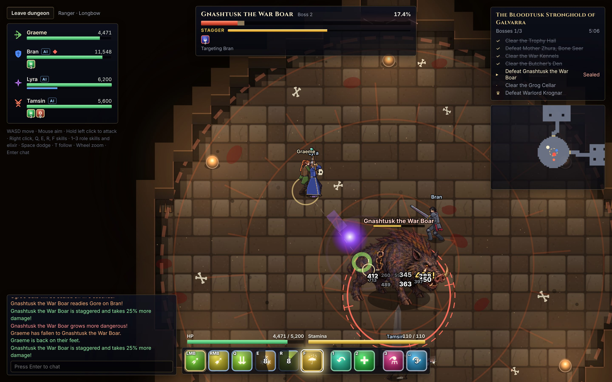
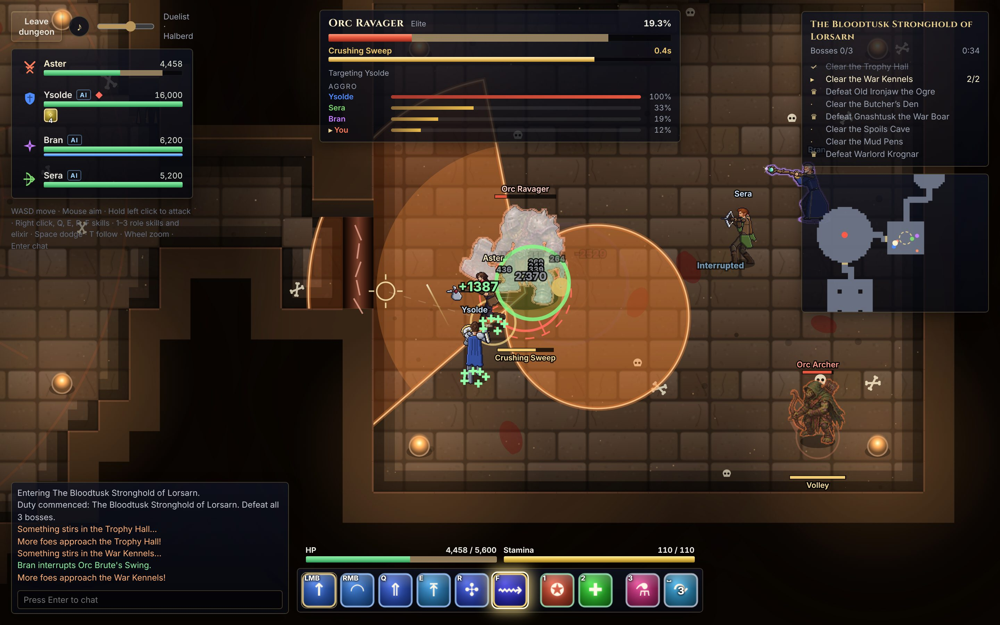
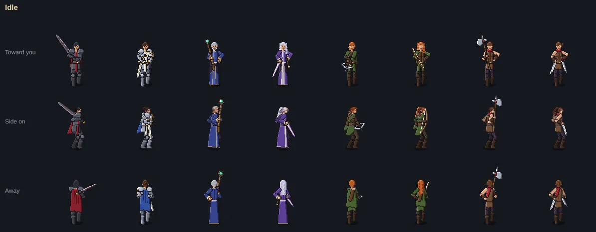
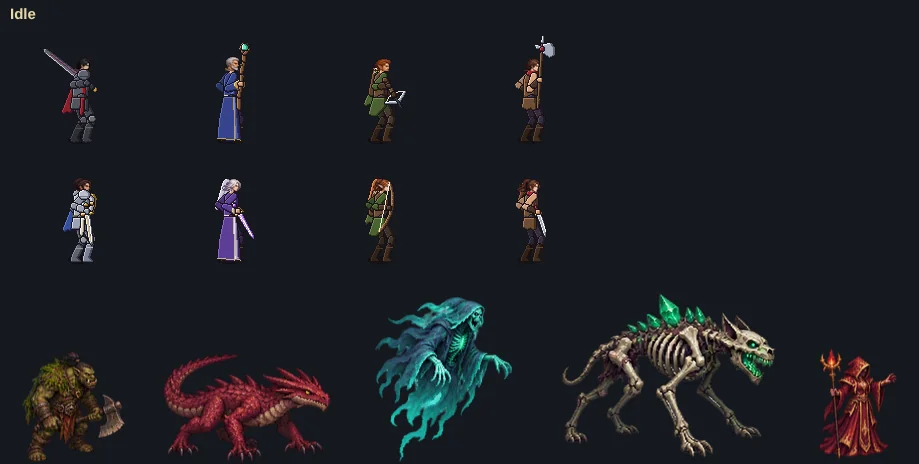
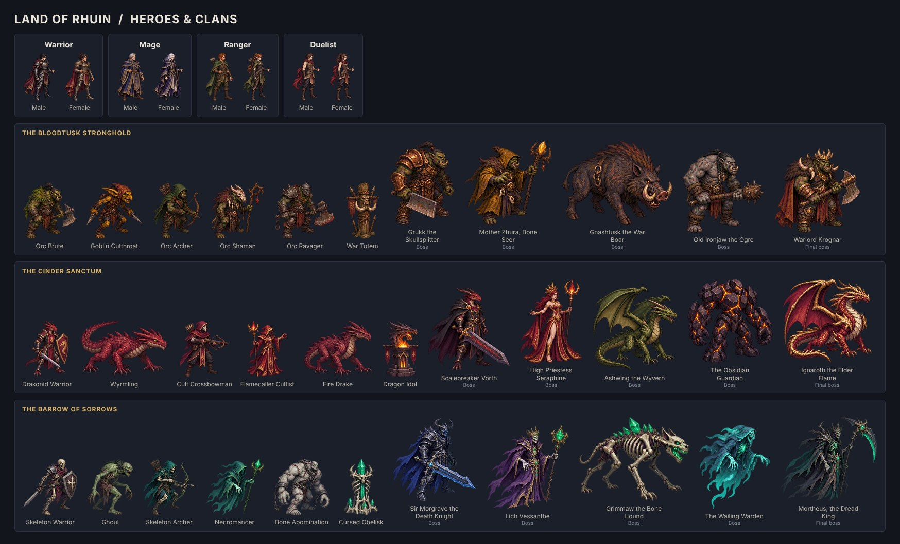

# Land of Rhuin

A four-player co-op hack-and-slash dungeon RPG that runs in the browser. Form a party of four (Tank,
Mage, Ranger and Duelist) and carve through a dungeon generated fresh for every run. Every dungeon
belongs to one of three monster clans: **Orcs**, **Dragons and their cultists**, or the **Undead**.
Each run has waves of monsters, then 3 or 4 bosses whose attacks are marked on the ground before
they land. Players queue together or alone, and AI companions fill any role nobody is playing.

Combat is aimed and hands-on. Hold the mouse to swing your weapon's combo, fire skills toward the
cursor, and dodge-roll through danger. The dungeon structure takes its cues from big fantasy MMO
dungeons: a finder queue with a ready check, aggro and taunts, sealed boss arenas, and orange
telegraphs to step out of. Teamwork is the heart of it: monsters hit far too hard for anyone but the
Tank to take, the Tank needs a healer to last, and the damage dealers have to keep their aggro
under the Tank's. All names, art, skills and bosses are original.




## Quick start

You need Node.js 20.19 or later.

```sh
npm ci
npm run build
npm start            # http://127.0.0.1:8787
```

Open the address, pick a name, choose a role and a hero, set **AI companions fill empty roles**
to **Now**, and press **Join Queue**. Accept the ready check with **Commence**.

To play with friends on your network, start the server with `npm start -- --host 0.0.0.0` and
have them open `http://<your-ip>:8787`. One player shares their **party code**; the others type
it into **Party code** and press **Join**. The party leader then joins the queue.

| Server option | Effect |
| --- | --- |
| `--port 8787` | Port for the web page and the game socket. |
| `--host 127.0.0.1` | Interface to listen on. Use `0.0.0.0` for LAN play. |
| `--quick` | Monsters have a quarter of their health. Good for trying things out. |
| `--countdown 5` | Seconds before the entrance barrier drops. |
| `--clan orc` | Make every dungeon belong to one clan: `orc`, `dragon` or `undead`. |
| `--companions flameWarden` | AI companions play these heroes (comma-separated hero ids) where their role has one, even a Mage who is not the healer. |

For development, `npm run dev` runs the server with reload on port 8787 and the Vite client on
http://localhost:5173 (it forwards the game socket to the server).

## Controls

| Input | Action |
| --- | --- |
| W A S D | Move |
| Mouse | Aim. Your hero always faces the cursor. |
| Hold left mouse | Basic attack: your weapon's three-hit combo |
| Right mouse | Weapon special |
| Q, E, R | Weapon skills |
| F | Weapon ultimate |
| 1, 2 | Role skills |
| 3 | Elixir (restores 35% HP) |
| Space | Dodge roll: a short roll during which nothing can hurt you. Costs stamina. |
| T | Follow the Tank, or the party member you selected |
| Tab, F1 – F4 | Select an enemy or a party member to see them in the target frame |
| Mouse wheel | Zoom |
| Enter | Chat |
| M | Music on or off (the ♪ button and slider by it set the volume) |

Every skill is aimed at the cursor:

- **Arcs and thrusts** hit everything in front of you.
- **Projectiles** fly until they hit something; some pierce or explode.
- **Ground skills** land where you point, some after a short delay, shown as a blue marker.
- **Dashes and leaps** carry you through or onto your enemies.

A few heavy skills have a short wind-up; moving or rolling cancels it.

## Roles and heroes

Pick a role, then one of its heroes. Each hero carries one weapon of their own, so choosing your
hero chooses your weapon. A role starts on its first hero until you pick another.

| Role | Strengths | Heroes |
| --- | --- | --- |
| **Tank** | The only hero who can take the monsters' blows: 16,000 health and 55% damage reduction. Builds three times the aggro, holds it, and loses it three times slower. Needs a healer in a long fight. *Rallying Bulwark* gives the whole party 20% damage reduction and a barrier. | **Dark Knight**: a two-handed greatsword · **Guardian**: sword and shield, a paladin with healing light |
| **Mage** | Offensive and healing spells. | **Sage**: a two-handed staff crowned with an orb (the healer) · **Spellblade**: a mystic sword and a wand |
| **Ranger** | High damage from range. A glass cannon: low health, 15% more damage taken. | **Arbalest**: a crossbow · **Bowmaster**: a longbow |
| **Duelist** (melee) | The highest damage in the party, and the easiest to fall: low health, 20% more damage taken. | **Dragoon**: a two-handed lance · **Blademaster**: twin blades · **Flame Warden**: a burning blade, and the Firebeast within |

| Weapon | Hero | Special (RMB) · Q · E · R · Ultimate (F) |
| --- | --- | --- |
| Greatsword (Tank) | Dark Knight | Parry · Stalwart Charge (dash through foes: a 0.5s stun, a great deal of aggro, and 35% less damage taken for 5s) · Eclipse (a full circle swing that slows) · Drain (damage all around; heals you for 60% of it) · Ruination (costs 50% of your maximum health: four massive strikes rain on your aim) |
| Sword & Shield (Tank) | Guardian | Aegis (shield up: 60% less damage) · Flash (dash through foes: a 0.5s stun, a great deal of aggro, and 35% less damage taken for 5s) · Mend (heals you for 18% and draws every foe nearby) · Shield's Up! (blocks all damage for 3s, then bursts for 30% of what it absorbed) · Luminaire (massive damage to every enemy in sight) |
| Staff | Sage (healer) | Mending Light (heal circle) · Arcane Orb · Sanctuary (healing ground) · Meteor · Resurrection |
| Mystic Sword & Wand | Spellblade | Runic Ward (barriers) · Spellblade Rush · Arc Lightning · Lifebinding Sigil (damage and heal) · Astral Cleave |
| Crossbow | Arbalest | Piercing Bolt · Explosive Bolt · Tumble Shot · Scattershot · Siege Barrage |
| Longbow | Bowmaster | Charged Shot · Volley · Snare Trap · Fan of Arrows · Rain of Ruin |
| Lance | Dragoon | Sweeping Strike · Piercing Thrust · Vault Strike · Whirling Lance · Skewer |
| Twin Blades | Blademaster | Rising Slash · Whirlwind · Blademaster's Lunge · Executioner · Cataclysm Blades |
| Ember Blade | Flame Warden | Blazing Crescent (a piercing crescent of flame) · Flashfire (a 6-tile dash that sets foes burning) · Inferno Burst (a blast just ahead of you that throws foes back) · Kindle (8s: attacks 25% faster, every foe struck catches fire) · Firebeast (see below) |

Role skills: the Tank has **Challenge** (taunt everything nearby) and **Rallying Bulwark**. The
Mage has **Arcane Blink** and **Mana Font**. The Ranger has **Vault** and **Field Dressing**. The
Duelist has **Bloodrush** (more damage dealt, more taken) and **Second Wind**.

The Sage's Staff is the party's healer. An AI companion filling the Mage slot is always the Sage
(unless the server is started with `--companions` naming another Mage, which comes first); the other
AI companions play any of their role's heroes. A party without a Staff gets the *Ward of Rhuin*: 15% less damage taken and a slow heal in combat.

In AI-only test runs, Duelists deal about 1,500 damage per second (the Flame Warden about 1,900),
Rangers about 1,150, Mages about 700 and Tanks 550 (Guardian) to 700 (Dark Knight).

### The Flame Warden and the Firebeast

The third Duelist is a fast, aggressive glass cannon. His **Ember Slash** combo is the quickest of
any Duelist (a cut every 0.4s, the third a wider sweep) and the shortest: 2.4 to 2.8 tiles, where
the Dragoon's thrusts reach 3.8 and the Blademaster's slashes 3.4. He is the Duelist with the most
sustained damage, and he pays for it by standing closest to what he fights.

His ultimate, **Firebeast** (F, a 90-second cooldown), engulfs him in flame: for 5 seconds he *is*
the Firebeast.

- **It only has its claws.** Holding the attack button swings the Firebeast's three-claw chain, one
  swipe every 0.45s through everything within 3 tiles in front of it, each at **potency 1000**. The
  form takes 0.8s to take shape, so a full form lands ten claws. Every other skill, the role skills,
  the Elixir and the dodge roll are refused until it ends (greyed on the hotbar, with a bar
  counting the form's seconds down).
- **No monster can hurt it.** Blows, bolts and arrows, every ground mechanic and damage over time
  (even from a monster that has since died) show **Immune** instead of a number. Knockbacks still
  move it, and the heroes around it are hit as ever. It still stands in the way: in a stack it takes
  its share, so the others' shares are smaller, and a shot that crosses it stops on it rather than
  flying on to whoever is behind.
- **Buffs.** The potency is fixed at 1000, and Kindle does not hurry the claws: the form is balanced
  on its ten swipes. Kindle's flames still catch on them, though: while it lasts, every foe a claw
  strikes burns, as it would under the Ember Blade. Bloodrush, the Echo of Rhuin and a staggered
  boss's weakness still raise the claws' damage, as they do every blow, because they multiply
  damage, not potency; Bloodrush has to be used first, since role skills wait during the form, and
  its cost (15% more damage taken) only bites once the form ends.
- **Aggro works as ever.** Ten claws at 1000 potency pull monsters onto the Firebeast. They cannot
  hurt it, but they are still after the Warden when the form ends, so he needs to be near the Tank
  by then (the hotbar warns him), and the Tank needs to take them back. A boss that begins a
  tank-buster on the Firebeast in its last four seconds lands it on the Warden once the form is gone:
  he has to roll through it (a roll is ready, since the form cannot spend stamina).

An AI Flame Warden takes the form when a fight worth it is on (a boss, or a pack with plenty of
health left in reach of his claws), and while transformed only attacks: no skills, no rolls, no
easing off his aggro and no running to the Tank. He ignores only the markers that land while the
form holds; one that lands after it is as deadly as ever, so he steps out of it as he would as the
Warden. Like every AI damage dealer, he rolls through a buster on him as it lands, the way that
keeps it off the others: one begun on the Firebeast, or one the boss begins on him after the form
because the claws' aggro still holds it. An AI Tank leaves the monsters on the Firebeast be and
saves its taunt until the form has 0.8 seconds left, then takes them all back, the boss too, so
they are on it when the form ends (sooner, and the last claws would pull them away again). A player
Tank's hotbar says how many are on the Firebeast and for how long, and counts them as loose for its
last second and a half.

What the sims show, with AI parties in the same 128 dungeons for each Duelist (64 seeds, each with
a Guardian–Sage–Bowmaster party and a Dark Knight–Sage–Arbalest one):

- Against a training dummy for two minutes, without his ultimate, the Flame Warden deals about
  1,600 damage per second to the Dragoon's 1,350 and the Blademaster's 1,300; with it, about 2,250
  to their 1,500. Against a pack of four his short reach tells: about 2,400 (4,100 with the
  Firebeast), behind the Dragoon's 2,750 and far behind the Blademaster's sweeping 4,950.
- Over whole dungeons he deals about 1,900 damage per second (1,917 and 1,868 in the two parties)
  to the Dragoon's 1,450 to 1,500 and the Blademaster's 1,500 to 1,550, about a quarter more, and
  every party clears every dungeon, his a little faster (about 12:20, against 12:50 to 14:10). The
  Firebeast comes out about nine times a run and deals about a fifth of his damage.
- He falls about as often as the other Duelists: 0.6 times a run (0.55 and 0.69 in the two
  parties), against the Dragoon's 0.7 (0.45 and 1.03) and the Blademaster's 0.5 (0.39 and 0.63).
  What kills him is what kills them: spread markers (31 of his 79 deaths), routine blows, ground
  areas and raid-wide blasts. Seven came within three seconds of a form
  ending, none of them a tank-buster.
- Busters used to be what killed him: about once a run, two in three of his deaths. An AI Tank
  charging to brace against a buster dragged it onto the Duelists behind the boss (0.7 to 0.8 deaths
  a run for him and the Blademaster, 0.25 for the Dragoon, whose reach keeps him further back); it
  now charges a way that keeps them clear. And no AI damage dealer tried to escape a buster begun on
  them, which cost him 0.3 deaths a run (the others 0.1), many of them from a boss his claws held on
  him past the Firebeast; now they roll through it as it lands. Those two fixes took his deaths from
  1.6 a run to 0.6, the Blademaster's from 1.5 to 0.5 and the Dragoon's from 0.9 to 0.7.
- The rest of his party pays a little for his claws in the Guardian's party: the others fall 0.9
  times a run with him, against 0.6 with the Dragoon and 0.4 with the Blademaster, and the party
  wipes 0.19 times a run against 0.14 and 0.05. The extra deaths are mostly the Mage and the Tank
  falling to routine blows (20 in 64 runs, against 6 with the Dragoon), which fits the monsters
  the claws held coming back from the Firebeast all at once. In the Dark Knight's party he sits
  between the two (others 1.5 a run against 2.2 and 1.1, wipes 0.33 against 0.59 and 0.27).
  Halving the claws' aggro brings the Guardian's party down to 0.6 and 0.08 for the same damage,
  but does nothing for the Dark Knight's (1.6 and 0.38), so the claws keep their full aggro.
- These counts are noisy. The two halves of the same 64 seeds can differ twofold for deaths and
  wipes (the others in the Blademaster's Dark Knight party: 0.75 and 1.41 deaths a run), so a
  difference of less than about half is not to be trusted, and 16 seeds are far too few to tune by.
- The cooldown, in 64 of the same dungeons: at 60 seconds his damage would rise by 5 to 7% (about
  2,000 a second), and at 120 it would fall by about 4% (about 1,800). Deaths and wipes did not
  follow it: the others in the Guardian's party fell 0.7 times a run at 60 seconds, 0.9 at 90 and
  0.2 at 120, and in the Dark Knight's 2.0, 1.4 and 1.6. 90 keeps him about a quarter ahead of the
  other Duelists.
- Alone against a pack of three with no Tank, he wins every time with the Firebeast ready, and falls
  like any Duelist with it on cooldown.

## Aggro and teamwork

Every monster keeps its own aggro table: how much each hero has drawn its attention. It attacks
whoever tops that table.

- **Damage builds aggro**, one point per point of damage. The Tank builds three times as much.
  Stalwart Charge and Flash build three times as much again, plus a flat 3,000. Eclipse, Drain,
  Ruination and Luminaire build half as much again.
- **Healing builds aggro** on every monster in the fight within 30 tiles of the healer: 0.6 per
  point actually healed. Overhealing does not count.
- **First contact** adds a flat 1,500 the first time a hero strikes a monster, twice that for the
  Tank, so whoever opens the fight gets its attention. Healing near a monster does not count
  as contact.
- **Unhinged damage builds aggro fast.** A hero's recent damage on a monster runs hot and cools by
  half every 2 seconds. Once it passes about 4,500, every blow counts double, rising to 3.5 times.
  A Duelist who unloads everything on one target pulls it.
- **Monsters are sticky.** To pull a monster off its target you need 10% more aggro than the
  target has, or 30% more if the target is the Tank.
- **Aggro fades** by 3% a second, the Tank's by 1%, so a Tank who keeps working holds what they
  have taken. **Challenge** puts the Tank at the top of every table within 9 tiles and
  turns those monsters on them at once.

Monsters hit hard. Blows aimed at their aggro target (routine swings and a boss's routine
attacks, heavy cleaves, bolts and arrows) deal three times the damage they used to, and tank
busters about 65% more. Wide area attacks and the other boss mechanics are unchanged. Monsters
have 80% more health than before and bosses 30% more, so fights last long enough for aggro to
matter.

What that means in a fight:

- Standing still with a pack of three on them, a Duelist, Ranger or Mage falls in 3 to 5 seconds.
  Fighting back with no Tank to run to, every one of them falls to a wave of five within 2 to
  11 seconds (the Flame Warden too, unless his Firebeast is ready). A pack of only three is a
  fairer fight: the Blademaster beats it about half the time, other damage dealers now and then,
  and the Sage can hold out for a minute by healing.
- A Tank lasts far longer: about 11 seconds standing still, and much longer fighting.
- Alone against a wave of five, the Dark Knight falls in 19 to 27 seconds and the Guardian in 30
  to 50. A Guardian who outlasts one wave falls to the next. With the Staff healer behind them,
  both clear wave after wave and usually end each one above three-quarters health.

Reading aggro on screen:

- **The target frame** lists the top four on your target's table, your own row marked. Each is
  a share of the aggro of the hero it is on, who reads 100%. The monster turns at 110%, or 130% if
  it is on the Tank. A row close to that line turns orange.
- **Over a monster's name:** a pulsing red **!** means it is coming for you. If you are the
  Tank, a gold **◆** marks the ones on you and an orange **◇** the ones loose on the party.
- **By the hotbar:** "Pulling aggro: 118% of the tank's (it turns at 130%) — ease off" when you
  are close to pulling a monster off the Tank; "You have aggro! … get to the tank" when
  something has come for you. The Tank sees "2 loose on the party — grab them!", or, for monsters
  on the Firebeast, how many there are and how long until they must be taken back.
- A hit your shield or barrier takes in full shows as **Blocked**; otherwise you see what got
  through.

AI companions play by the same rules. Damage dealers ease off a monster when they come close to
the Tank's aggro, and run to the Tank when something comes for them. An AI Tank charges
and taunts whatever gets loose. A hero with a tank-buster on them never dashes or leaps to where
it would land on someone else, since it follows them wherever they go. That matters most for the
Tank, which charges to brace against a buster (both charges give 35% less damage taken): straight
through the boss would carry the buster onto the Duelists behind it, too late for them to step out,
so it charges the nearest way that keeps them clear (or not at all). A damage dealer who has pulled
a boss cannot outrun a buster on them either, and it kills anyone but a braced Tank: they roll
through it as it lands (or dash through it on a skill that cannot be hurt), the way that keeps it off
the others.



## Heroes and clans

Every role has its own heroes to choose from in the lobby, each with their own weapon, and every
hero is a big-headed chibi painted in code frame by frame (see [Chibi heroes](#chibi-heroes)):

- **Dark Knight** (Tank): a hard-eyed young knight with long, wild, nearly black hair in jagged
  spikes swept back from his face, blackened plate, a long open oxblood coat and an oversized black
  greatsword.
- **Guardian** (Tank): a paladin in polished silver plate with blue enamel and gold trim, golden
  hair tied back under a silver circlet, a long cape, an arming sword and a kite shield with a sun
  rising behind a white tower.
- **Sage** (Mage): an old healer with a white mane and a full white beard, a deep blue robe with a
  gold-embroidered stole, and a gnarled staff with a teal orb held in silver claws.
- **Spellblade** (Mage): a slim young mage with long silver-white hair, a violet robe-coat and a
  short cape, a slender sword and a crystal wand.
- **Arbalest** (Ranger): a sturdy crossbowman with short ginger hair and a beard, brass goggles
  pushed up on his brow, a weathered leather coat, a bandolier of bolts and a heavy crossbow.
- **Bowmaster** (Ranger): a light-footed archer in a forest-green hood and short hooded cape, with
  a dark recurve longbow and a quiver of pale-fletched arrows.
- **Dragoon** (Duelist): a lean lancer in dark violet dragon-scale armour and an open-faced
  dragon-crest half-helm, a long black ponytail, a violet-black cape lined in crimson and a lance
  taller than he is.
- **Blademaster** (Duelist): a quick duelist with a messy dark bob, a black coat lined in crimson
  with swallowtails to her knees, and two curved sabres.
- **Flame Warden** (Duelist): a lean swordsman with spiky black hair, a long black coat lined in
  ember orange over a crimson shirt, and a single-edged sword glowing with heat. His ultimate turns
  him into the **Firebeast**, a hulking beast of charred obsidian hide cracked with magma, with a
  mane of living flame.

Weapons are part of each hero's animation, held the way they are meant to be held: the Dark
Knight's greatsword, the Sage's staff and the Dragoon's lance in both hands, the Guardian's sword
and kite shield, the Spellblade's sword and wand, the Arbalest's crossbow shouldered, the
Bowmaster's longbow drawn to her chin, the Blademaster's twin sabres and the Flame Warden's
burning blade. Heroes turn to face where they are aiming: side on to the left and right, toward
you when they face down the screen and away from you when they face up it, in every clip.




### Animation

Heroes have sixteen clips each (see [Chibi heroes](#chibi-heroes)). Every monster and boss is
animated through five:

| Clip | When it plays | Monsters and bosses |
| --- | --- | --- |
| **Idle** | Out of combat | Breathing, a robe or a wraith swaying |
| **Battle** | While they are after someone | A ready stance, bouncing |
| **Move** | Walking | Legs stepping, the body rising and falling |
| **Action** | Basic attacks | A wind-up, then a lunge into the blow with a motion smear, and a recovery |
| **Skill** | Skills and spells | A crouch gathering their clan's glow, then a release with a flash |



The server tells every client when anyone attacks or uses a skill, and how long they wind up, so
everyone sees the same animation in time with the telegraphs. Characters still flash when hit and
fall when knocked out.

Each dungeon is the lair of one clan, with its own monsters, bosses, rooms, colours and floor:

| Clan | Dungeon | Monsters | Bosses |
| --- | --- | --- | --- |
| **Orcs** | The Bloodtusk Stronghold: torchlit earth, bones, blood and stakes | Orc Brute, Goblin Cutthroat, Orc Archer, Orc Shaman, Orc Ravager, War Totem | Grukk the Skullsplitter, Mother Zhura the Bone Seer, Gnashtusk the War Boar, Old Ironjaw the Ogre, and Warlord Krognar |
| **Dragons** | The Cinder Sanctum: obsidian, glowing lava cracks and drifting embers | Drakonid Warrior, Wyrmling, Cult Crossbowman, Flamecaller Cultist, Fire Drake, Dragon Idol | Scalebreaker Vorth, High Priestess Seraphine, Ashwing the Wyvern, the Obsidian Guardian, and Ignaroth the Elder Flame |
| **Undead** | The Barrow of Sorrows: cold stone, graves, cobwebs and green mist | Skeleton Warrior, Ghoul, Skeleton Archer, Necromancer, Bone Abomination, Cursed Obelisk | Sir Morgrave the Death Knight, Lich Vessanthe, Grimmaw the Bone Hound, the Wailing Warden, and Mortheus the Dread King |



| Orcs | Dragons | Undead |
| --- | --- | --- |
|  |  |  |
|  |  |  |

The art lives in `src/client/art/`. Monsters and bosses are transparent pixel sprites in
`creatures/`, each with a ground anchor and a display height. Their frames are built as they load
(`animation.ts`): each gets a rig (`rigs.ts`) of two legs, a robe, four legs, a hovering form, or a
rigid object such as a totem, and the rig is posed frame by frame, bending the original artwork.
Heroes have no artwork to bend: they are painted in code (`heroes/chibi/`), and their lobby and
title portraits are painted from their battle stance.

### Chibi heroes

Every hero is a chibi (`heroes/chibi/`): a big-headed pixel hero about 80 to 85 pixels tall (two
to two and a bit tiles in the dungeon), a third of it head and hair, painted in code frame by frame from a 3D rig.
Every pose is solved in 3D and painted in three views: side on (a three-quarter view, mirrored to
face left), toward you and away from you. The Firebeast, the form the Flame Warden takes, is one
too: bigger, 108 pixels and about 2.6 tiles tall.

Each has the same sixteen clips. The server's act event names the skill used (`s`) and the hit of
the combo (`c`), so everyone sees the right one. The weapon-skill clips are named after the
skill's hotbar slot, so a skill plays the clip of its slot whatever its weapon. When several apply
(`game/chibiState.ts`), knocked out wins, then an attack or skill playing out, then running or
dodging, then the victory pose (which holds its last frame), a flinch, kneeling, the battle stance
and idling. The skill and state clips take the weapon up from where the battle stance holds it,
and those that give way to the stance end in it. Wind-up frames stretch over the wind-up the
server times; a ranged hero looses on the first frame after them, with a flash at the tip, when
the game launches its own projectile.

| Clip | Played by |
| --- | --- |
| `idle`, `battle`, `move` | Out of combat; a fight nearby; running and dodging |
| `atk1`, `atk2`, `atk3` | The basic attack's three hits |
| `special`, `q`, `e`, `r`, `ult` | The weapon's skills by hotbar slot: RMB, Q, E, R and F |
| `cast` | Role skills and the Elixir |
| `hurt`, `kneel`, `ko`, `victory` | A blow that gets through; below a quarter of their health; knocked out; the dungeon cleared |

**The Dark Knight**, a Tank, is a hard-eyed young knight about 84 pixels tall. His long, wild,
nearly black-brown hair is all jagged spikes swept back from his face: three or four spiky bangs
fall over his brow between his eyes, spikes stick out at his sides behind the ears, and the
longest fall past his nape onto his upper back and flare out. His face is set and tough: narrow
red-brown eyes under heavy brows angled down to his nose, and a strong jaw. He wears blackened
plate with dull silver edges, a long open oxblood coat with a high collar and split tails, and
carries an oversized black greatsword with a pale edge, a saw-toothed back and a crimson rune that
blazes when he fights. His swings leave white-hot arcs that fade through crimson, and his skills
burn crimson with a violet edge (`heroes/chibi/darkKnight/`):

| Clip | Frames | The Dark Knight |
| --- | --- | --- |
| `idle` | 8 | Breathing, the greatsword on his shoulder, the coat swaying |
| `battle` | 8 | A low, wide guard, the blade held forward and across, bouncing |
| `move` | 8 | A sprint, the blade trailing low behind him, the coat and his spikes streaming |
| `atk1`, `atk2`, `atk3` | 7, 7, 9 | A diagonal cut, a rising backhand, then a spin, a leap and a slam with a shockwave |
| `special` | 5 | Parry: the blade up across his body, a clang, sparks, a braced skid |
| `q` | 8 | Stalwart Charge: a shoulder-first dash with crimson afterimages and a skidding stop |
| `e` | 10 | Eclipse: a full turn with the blade held out level inside a ring of steel |
| `r` | 10 | Drain: the blade plunged into the ground, wisps of stolen life drawn into him |
| `ult` | 16 | Ruination: a mist of blood, a leap, four blows as he falls and a ground slam |
| `cast` | 8 | A roar, the blade thrown high, an aura burst over a rune circle |
| `hurt`, `kneel`, `ko`, `victory` | 3, 4, 6, 8 | A flinch, the coat flicked forward; on one knee leaning on the planted blade, panting; a stagger, onto his knees and onto his back; the blade twirled overhead, then rested on his shoulder with a smirk |

**The Guardian**, a Tank, is a paladin about 82 pixels tall, sturdy but lighter than the Dark
Knight, kind but steely: golden hair swept back and tied low with a blue ribbon under a slim silver
circlet with a blue gem, polished silver plate with a blue enamel panel edged in gold, rounded
pauldrons, a short blue tabard and a violet-navy cape lined in crimson. She carries a long arming
sword with a gold guard, whose fuller glows gold in her skills, and a large kite shield strapped
to her left forearm: a blue field in a broad gold rim, a sun rising behind a white tower. Her light
is gold and white with a pale blue edge (`heroes/chibi/guardian/`):

| Clip | Frames | The Guardian |
| --- | --- | --- |
| `idle` | 8 | Upright, the sword hanging point down, the shield resting point down by her foot, the cape and her tail swaying |
| `battle` | 8 | On guard behind the shield, its face to you, the sword cocked high over her shoulder to cut over its rim |
| `move` | 8 | A sprint, the shield carried forward, the sword trailing low behind her, the cape streaming |
| `atk1`, `atk2`, `atk3` | 7, 7, 9 | A diagonal cut over the shield's rim; a rising backhand up the same line; the shield driven in with a burst of light, then a heavy chop that rings off the floor with a shockwave |
| `special` | 6 | Aegis: the shield swung up square before her and set, a gold glint running down its face |
| `q` | 8 | Flash: a dash shield first in a flash of light, gold afterimages, a skid and a braced stop |
| `e` | 10 | Mend: the sword raised point up before her face, eyes closed, a column of gold light pouring down on her |
| `r` | 10 | Shield's Up!: a dome of gold hexagons rises over her and holds, then breaks outward in gold shards |
| `ult` | 14 | Luminaire: light gathers on the raised sword, then rays of light burst out all round her and flood the floor |
| `cast` | 8 | The sword's flat struck on the shield's rim with a ring of light, then raised high, rays off its point |
| `hurt`, `kneel`, `ko`, `victory` | 3, 4, 6, 8 | A flinch, the shield arm flung wide; on one knee behind the shield planted on its point; a stagger and a fall onto her back, the shield flat beside her; the sword wheeled round and raised beside her head with a glint and a smile |

**The Sage**, a Mage and the party's healer, is an old, wise mage about 80 pixels tall (92 to the
orb of his staff at rest): weathered skin, kind but stern blue-grey eyes under bushy white brows, a white
mane to his shoulders, a full white beard to the middle of his chest that sways as he moves, a
full-length deep blue robe with wide sleeves and gold trim, a gold-embroidered stole, a hood lying
down behind his neck, and a staff taller than he is: gnarled dark wood bound in silver, a glowing
teal orb held in silver claws. His bolts and wards burn teal, his healing glows gold-green and his
Meteor fiery orange (`heroes/chibi/sage/`):

| Clip | Frames | The Sage |
| --- | --- | --- |
| `idle` | 8 | Stooped a little, leaning on the planted staff, his left hand behind his back, the beard and robe swaying |
| `battle` | 8 | Straightened, the staff in both hands slanted forward, the orb pulsing at his brow, a slow sway |
| `move` | 8 | An old man's hurried run, short strides under the robe, beard, hair and robe streaming |
| `atk1`, `atk2`, `atk3` | 7, 7, 8 | Arcane Bolts: a flick of the staff, a backhand sweep, then a ball of light swelling in the orb and hurled two-handed |
| `special` | 7 | Mending Light: the orb turns gold-green and swells, then a soft crescent of healing light leaves it for the aim |
| `q` | 7 | Arcane Orb: the staff swung back while a great teal orb forms, then swung forward to push it away |
| `e` | 10 | Sanctuary: the staff struck down upright, a ring of teal runes and soft columns of healing light rising round it |
| `r` | 10 | Meteor: the staff thrust at the sky, a fiery sigil opening above it, then swept down at the aim as a ball of fire bursts out |
| `ult` | 16 | Resurrection: a long chant, the staff raised overhead at the top of a pillar of gold light, rings and feathers of light rising, then a burst of warm rays |
| `cast` | 8 | A quick twirl of the staff in a teal arc, then planted with the orb flaring and a teal circle under him |
| `hurt`, `kneel`, `ko`, `victory` | 3, 4, 6, 8 | A flinch, the beard and robe flicked forward; on one knee leaning on the staff, a hand to his chest; a crumple onto his back, the beard spilling over his chest; the staff raised high, the orb blazing, chin up and a warm smile |

**The Spellblade**, a Mage, is a slim, quick young mage about 80 pixels tall with a soft, fair
face: long, straight silver-white hair to the middle of her back, two long locks framing her face
and a small gold crescent pin in her side-swept fringe, a fitted violet robe-coat with a high
gold-edged collar, cut away at the front and falling to the knee behind, over a pale lavender
under-dress, a violet sash with a gold buckle, a short deep-violet cape, dark plum leggings and
slim pointed boots. She fights with a slender sword with a violet fuller in her right hand and a
short wand with a violet crystal in her left. Her blows leave white-edged violet arcs; her spells
are gold runes, violet lightning and green-gold healing light (`heroes/chibi/spellblade/`):

| Clip | Frames | The Spellblade |
| --- | --- | --- |
| `idle` | 8 | At ease, weight on her back foot, the sword hanging point down, a blink and a little twirl of the wand |
| `battle` | 8 | A light fencer's guard side on: the sword up and forward, the wand low and ahead with its crystal pulsing, bouncing on her toes |
| `move` | 8 | A quick, light sprint, the sword trailing low behind her and the wand held ahead, the hair streaming and swinging |
| `atk1`, `atk2`, `atk3` | 7, 7, 9 | A diagonal cut from high behind her shoulder; a flat backhand sweep from a coil; then the wand charges the blade and a lunging sweep throws a crescent wave of violet force |
| `special` | 7 | Runic Ward: the wand raised ahead of her face drawing a circle of light, a ring of her own gold runes spinning up round her and closing over her as a dome |
| `q` | 8 | Spellblade Rush: coiled low, then a dash with the point thrust ahead, violet afterimages and streaks of speed, a braced skid |
| `e` | 8 | Arc Lightning: the wand drawn back by her shoulder, then thrust ahead as lightning crackles from its crystal |
| `r` | 10 | Lifebinding Sigil: the sword driven point down into the floor; a green-gold rosette blooms round her and petals of light spiral up |
| `ult` | 14 | Astral Cleave: the sword raised high while the wand pours light into it and a great translucent blade grows from its point, then a two-handed cleave and a rift of light running on the way she faces |
| `cast` | 8 | The wand twirled in an arc of light and flung up high in a flourish, a quick spell circle and sparkles spiralling up |
| `hurt`, `kneel`, `ko`, `victory` | 3, 4, 6, 8 | A flinch, the coat and cape flicked forward; on one knee by the planted sword, the wand hand on her chest; a stagger and a crumple onto her back, the hair fanned out over the floor; the sword held out high to her right, a hand on her hip and a wink |

**The Arbalest**, a Ranger, is a compact, sturdy crossbowman about 84 pixels tall with a tanned,
weathered face, sharp grey-green eyes, short ginger hair swept back and a short ginger beard, brass
goggles with amber lenses pushed up on his forehead, a weathered brown leather coat belted over a
slate-blue padded jerkin, a steel pauldron on his leading shoulder and a bandolier of bolts across
his chest. His heavy crossbow has a walnut stock with brass bands, a steel prod, a cocking lever he
racks after every shot, and bolts with orange fletching. His shots flash amber with a white core
and leave pale gold trails (`heroes/chibi/arbalest/`, with his gear and effects in `gear.ts` and
`effects.ts`):

| Clip | Frames | The Arbalest |
| --- | --- | --- |
| `idle` | 8 | At ease, the crossbow at his hip, his thumb hooked in his belt, a glance aside |
| `battle` | 8 | The crossbow shouldered, feet planted wide and braced, a soldier's steady breathing |
| `move` | 8 | A heavy run, the crossbow at his hip, the coat tails flicking |
| `atk1`, `atk2`, `atk3` | 6, 6, 7 | Cheek to the stock, then the string snaps forward with a flash and a trail and the lever is racked; the same from a lower crouch; a heavier shot that kicks him back a step |
| `special` | 8 | Piercing Bolt: a steadied aim, the bolt's head glowing, a white-hot streak and a strong kick |
| `q` | 9 | Explosive Bolt: the loaded bolt burning amber, a fiery muzzle burst, a fresh glowing bolt laid in |
| `e` | 9 | Tumble Shot: a snap shot from a crouch as he springs back into a backward roll, up on one knee |
| `r` | 8 | Scattershot: braced low, a blast of shrapnel fanning out in a cone of sparks, a skid back |
| `ult` | 16 | Siege Barrage: feet planted, a rapid string of bolts across a narrow arc, racking between shots, the last the heaviest |
| `cast` | 8 | The crossbow slung on his back, a bandage bound round his forearm in warm motes, then shouldered again |
| `hurt`, `kneel`, `ko`, `victory` | 3, 4, 6, 8 | A flinch, the crossbow's nose flung up; on one knee, the crossbow across his thigh; a fall onto his back, the crossbow skidding away; the crossbow propped on his shoulder, goggles pulled down, a grin |

**The Bowmaster**, a Ranger, is a slim, light-footed archer about 80 pixels tall, calm and
keen-eyed: a forest-green hood worn up over dark brown hair (it falls back in her victory and her
fall), a short hooded cape to her elbows, a dark leather jerkin laced up the front over cream
sleeves, bracers and a shooting glove, tan trousers and tall boots. She holds a recurve longbow of
dark reddish wood with horn tips in her left hand and draws it to her chin with her right, its
limbs bending and the string running through her fingers, with a quiver of pale-fletched arrows on
her back. Her effects are a verdant green-gold, her ultimate's dark arrow violet-black
(`heroes/chibi/bowmaster/`):

| Clip | Frames | The Bowmaster |
| --- | --- | --- |
| `idle` | 8 | At ease, the bow upright in her left hand, a glance toward you, the cape swaying |
| `battle` | 8 | A light, bladed stance, the bow canted low with an arrow nocked, a springy bounce |
| `move` | 8 | A light, quick run, the bow carried low ahead of her, the cape streaming |
| `atk1`, `atk2`, `atk3` | 7, 7, 9 | A snap to full draw, loosed with a flash and a streak, then a fresh arrow from the quiver; a snap shot from a low crouch; a skip back and a full draw loosed hard as she lands |
| `special` | 8 | Charged Shot: a slow full draw as light gathers at the arrowhead, then a huge flash and a long streak that rocks her back |
| `q` | 9 | Volley: leaning back, three arrows loosed at the sky one after another |
| `e` | 7 | Snare Trap: a coiled snare unhooked from her belt and tossed underarm toward the aim |
| `r` | 8 | Fan of Arrows: five arrows on the string, the bow canted flat, loosed in a level fan |
| `ult` | 12 | Rain of Ruin: a crouch gathering dark power, a leap, a dark arrow loosed skyward in a violet streak, a landing as green sparks fall |
| `cast` | 8 | A light backflip, the bow kept out to her side, landing in a crouch |
| `hurt`, `kneel`, `ko`, `victory` | 3, 4, 6, 8 | A flinch, the bow flung out; on one knee, the bow planted on its tip; a fall onto her back on her spread cape, the hood sliding back; the arrow twirled and slid into the quiver, the hood pushed back, a smile and a wink |

**The Dragoon**, a Duelist, has a new look: a lean, long-legged young lancer about 84 pixels tall to
the top of his helm (93 to the tips of its frills), narrow amber eyes and a cocky half-smile, in light dragon-styled armour
of dark indigo steel with pale lilac edges. His open-faced dragon-crest half-helm has a brow band
dipping to a snout point over his nose, overlapping scales on the cheek guards, and a frill of three
swept-back blades behind each temple like a dragon's folded wing; his jet-black hair, blue in its
sheen, shows at the fringe and falls from under the back of the helm in a long ponytail. A
scale-patterned breastplate, layered wing-like pauldrons swept back to points, vambraces ending in
claws over the knuckles and greaves with a spur at the knee go over a charcoal under-suit, with a
violet-black cape to below the knee, lined in crimson and cut like a wing's trailing edge. His lance
is taller than he is: a dark steel shaft with violet wraps, a long leaf point glowing violet and a
vamplate of spread dragon wings below it. His energy is violet with a pale lilac edge and a
white-hot core (`heroes/chibi/dragoon/`):

| Clip | Frames | The Dragoon |
| --- | --- | --- |
| `idle` | 8 | The lance shouldered, sloping up and back past his head, a thumb in his belt, sparks drifting off the point |
| `battle` | 8 | A low, bladed spear stance, left foot and hand leading, the point forward and up, bouncing on his toes |
| `move` | 8 | A sprint, the lance carried low at his hip with its point trailing, the cape and ponytail streaming |
| `atk1`, `atk2`, `atk3` | 7, 7, 9 | A quick low jab; a downward stab from high by his ear; a deep coil, a hop and a long lunge from the butt end of the haft with a burst of violet energy |
| `special` | 7 | Sweeping Strike: the lance swung round low and wide, a level violet arc and a gust |
| `q` | 8 | Piercing Thrust: drawn far back while the point gathers its glow, then a deep lunge and a long spiral of violet energy |
| `e` | 11 | Vault Strike, the dragoon's jump: a crouch, a launch straight up and out of the frame, then a dive back point first with the cape spread like wings, landing in a burst of rays and a ring |
| `r` | 10 | Whirling Lance: two fast turns with the haft held level, a violet ring round him |
| `ult` | 12 | Skewer: the lance couched, a charge in long bounding strides with violet echoes behind him and a spearhead of light at the point, a great burst and a skidding stop |
| `cast` | 8 | The lance spun once round his hips and planted upright, a flare of violet rays |
| `hurt`, `kneel`, `ko`, `victory` | 3, 4, 6, 8 | A flinch, the lance jerked up and back; on one knee leaning on the planted lance; a fall, the lance clattering down and the cape spilling; the lance twirled in a violet wheel and planted, a hip cocked and a grin |

**The Blademaster**, a Duelist, is a slim, quick young duelist about 80 pixels tall with pale skin,
sharp crimson eyes and a confident smirk, a short, messy dark-brown bob with an upright lock on her
crown that springs as she moves, held back by a small clip shaped like crossed blades, a fitted
black coat with a high collar, crimson cuffs and swallowtails lined in crimson, a wine-black vest, a
crimson sash and black boots to the knee. She fights with two curved sabres of dark steel with a
crimson edge that blazes as she strikes; her cuts leave crimson arcs and her spins a violet-blue
whirlwind (`heroes/chibi/blademaster/`):

| Clip | Frames | The Blademaster |
| --- | --- | --- |
| `idle` | 8 | A hip cocked, one sabre resting on her shoulder and the other held reversed along her forearm |
| `battle` | 8 | Low and coiled like a cat about to spring, one sabre forward at eye height, the other reversed and low |
| `move` | 8 | A fast, low sprint, both sabres trailing back from her hips like wings |
| `atk1`, `atk2`, `atk3` | 7, 7, 9 | A cut ripped down across her body; the other blade's rising reverse answer; a full turn with both blades out, then both swept flat across in front of her, crossing |
| `special` | 7 | Rising Slash: a deep crouch, then both sabres ripped up in rising crimson arcs as she springs off the floor |
| `q` | 10 | Whirlwind: two full turns with both blades level inside bands of violet-blue wind |
| `e` | 8 | Blademaster's Lunge: a lunge so low her body is nearly level, crimson afterimages behind her, the blades whipped forward in a scissor as she skids to a stop |
| `r` | 10 | Executioner: both blades crossed high, a hop, then a giant crimson X slammed down through the floor |
| `ult` | 14 | Cataclysm Blades: a huge violet-blue funnel of wind gathers round her, then a ruinous spin inside it, crimson slash marks cut all round her |
| `cast` | 8 | The blades crossed under her chin, a crimson flare climbing her body from a sigil on the floor |
| `hurt`, `kneel`, `ko`, `victory` | 3, 4, 6, 8 | A flinch, both blades flung out; on one knee, one sabre planted ahead, the other held back ready; a fall onto her back, both sabres clattering down; both blades twirled, then crossed behind her back with a smirk and a wink |

**The Flame Warden**, the third Duelist, is a lean, quick young swordsman about 84 pixels tall with
tanned skin, sharp amber-orange eyes that glow faintly, and black hair in spikes swept back from his
face whose ends flick up like flames, warming to a red-orange sheen in his skills. He wears a long
black coat with a high collar and coat-tails to the calves, lined in ember orange that flashes when
it streams, a short black hooded cape with the hood down, a crimson shirt under a dark leather
strap, a blackened-iron pauldron and gauntlet on his sword arm, and armoured boots. His single-edged
longsword is dark steel whose edge glows with heat from orange to white-hot. His fire is orange with
a gold edge and a white-hot heart, his blasts ringed in pale violet shock, his buff a gold starburst
(`heroes/chibi/flameWarden/`, his fire in `fire.ts`):

| Clip | Frames | The Flame Warden |
| --- | --- | --- |
| `idle` | 8 | Weight on his back foot, the sword hanging at his side, a fist on his hip and a smirk, embers rising off the blade |
| `battle` | 8 | A low, forward-leaning crouch, always about to spring, the blade trailing low behind him, its edge glowing |
| `move` | 8 | A sprint, leaning hard, the blade trailing low, the coat streaming |
| `atk1`, `atk2`, `atk3` | 7, 7, 9 | Ember Slash: a rising slash in a blazing arc; a downward diagonal cut; a full turn with the blade out inside a ring of fire, ending in a sweep that bursts into flame |
| `special` | 7 | Blazing Crescent: a rising slash that throws a crescent of flame off the blade's edge |
| `q` | 8 | Flashfire: a low dash in place, afterimages in his fire and a lane of fire on the floor, a skid in a spray of embers |
| `e` | 9 | Inferno Burst: the blade thrust ahead, a fireball blooming at its point with a pale violet shock ring |
| `r` | 10 | Kindle: fists clenched, then thrown upright in a gold starburst of rays, his hair and coat lifting in the heat |
| `ult` | 10 | Firebeast: fire rises from a ring at his feet up his body as he roars, engulfing him in a pillar of flame |
| `cast` | 8 | A hand raised high, a flare of fire in it ringed with green light of healing |
| `hurt`, `kneel`, `ko`, `victory` | 3, 4, 6, 8 | A flinch, the coat tails flicked forward; on one knee, leaning on the planted sword, its fire burnt low; a fall on his side, the coat spread over the floor; the sword flicked to shake its flames off, then rested on his shoulder with a grin |

**The Firebeast** is the form he takes: an upright, hunched and hulking beast on the same biped rig
but bigger (about 108 pixels tall), charred obsidian hide and plates cracked with glowing magma
seams, a great mane of living flame round its head and shoulders, white-gold eyes ringed in the
Warden's amber, a fanged muzzle whose maw glows red, long dark claws with white-hot points like his
blade's glow, digitigrade legs, a thick tail with a mane of flame along its end, and a scrap of his
crimson shirt knotted round its waist with a tatter of his black coat behind. Its fire flickers
every frame (`heroes/chibi/firebeast/`, its fire in `fire.ts`). The game plays its stances, run,
claw chain, `ult` and `cast`; the rest exist as every chibi's must:

| Clip | Frames | The Firebeast |
| --- | --- | --- |
| `idle`, `battle`, `move` | 8, 8, 8 | Hunched and breathing fire between breaths; a low crouched snarl, both claws up; a loping run on two legs, the mane and tail streaming |
| `atk1`, `atk2`, `atk3` | 7, 7, 9 | The claw chain: a raking claw down across in front; a rising backhand scooped up from the floor; rearing up, then a lunging maul of both claws into the floor, fire bursting up with a pale violet shock ring |
| `ult` | 7 | It emerges: the column of fire the Warden's `ult` ended on bursts open round it as it roars, arms flung wide |
| `cast` | 8 | It collapses back into flame, curling down into the same column, which hides it as the Warden returns |
| `special`, `q`, `e`, `r` | 6, 8, 8, 8 | A roar breathing a gout of fire; a pounce in fiery afterimages; both fists hammered into the floor; a flexing roar in a gold starburst |
| `hurt`, `kneel`, `ko`, `victory` | 3, 4, 6, 8 | A flinch, its fire flaring; down on one knee, its fire burning low; a collapse into embers and smoke; a roar at the sky in a burst of flame |

A chibi hero's frames (339 to 375, a third of them per view) are painted in the background as a
dungeon loads, a frame at a time in slices of about 12 milliseconds, so the page never stalls (a
frame takes 4 to 8 milliseconds on average in Node). Each frame is cropped to what is painted and the crops
are shelf-packed into one atlas per view (`atlas.ts`), 700 to 1,300 pixels on a side. Side on comes
first; the views toward and away from you follow once the rest of the party and the monsters have
their frames; until then the hero is drawn side on whichever way they face, and before their side
view is painted, as a plain figure.

To add a chibi hero, give it a folder like `heroes/chibi/darkKnight/`:

- a design file (`ChibiDesign` in `design.ts`): proportions, four-tone materials, aura colours,
  and:
  - the head (`head.ts`): its locks of hair (pointed clumps with their own curl, give and widest
    point; a lock with `bob` stands up from the crown and springs as he moves, an ahoge; one with
    `stand` stands straight out as a stiff spike where it is seen end on, so hair swept back reads
    as a ring of points from in front or behind); the hair's `shell`, the clumps painted on the
    back of the shell fanning from a `whorl`, and a `hairline` whose `shadow` says how deep the
    fringe shades the brow; long
    hair if it has any (a curtain down the back laid out with `curtain`, locks over the shoulders,
    a tied ponytail with a `sheen` for glossy dark hair; short layers at the nape, painted with the
    head, whose ends can `flip` out, as in a layered cut); hair worn up (`buns`: one or two buns,
    a twist, a high updo); facial hair (a `beard`, laid out full, short or pointed by `beard`, and
    a `moustache`, which hang from the jaw, sway with the wind, show beside the jaw from behind and
    leave every expression readable; a beard's tresses pass over or under a held item by which is
    nearer where they cross); and a face style (`FACE_PLAIN`, `FACE_SOFT`, `FACE_SHARP` or its own
    glyphs) with a resting expression;
  - head pieces, given the head's frame as painted so they stay on the hair: a hairpin or its
    own, a high collar or a gorget (`collar`, closed and with `lames`), a scarf's wrap, and gear
    from `headgear.ts`: a `hood` worn up over the hair or down on the shoulders (the pose's `hood`
    says which), an open-faced `helm` (a brow band, cheek guards, a ridge, `scales` and swept-back
    `fins`, painted as flat plates with `Part.facet`) and a `circlet` or headband with a gem. Gear
    over the hair hides the hair under it but for a fringe hanging out from under its edge; long
    hair grown under it comes out from under its edge (below a helm, out of a hood's opening);
  - the limbs and boots (`BodyDesign`; a boot's `foot` can taper a soft boot to a point) and the
    torso's materials point by point (`armour.ts` `scaleAt` patterns a scaled breastplate);
  - outfit pieces (`pieces.ts`): pauldrons (`plates`, scaled with `scales`), a skirt of panels (a
    coat, a robe, a split skirt; `legs` keeps a long one clear of striding legs, so a full-length
    robe reads as one garment in every clip), a cape, a `cowl` (a short hooded cape over the
    shoulders and upper arms), a scarf's tails (they can taper, wave and climb behind the
    shoulders seen front on), or its own pieces built on `strand`; and things on the back
    (`back.ts`): a `strap` or bandolier across the chest with studs or bolts along it, a `quiver`
    of arrows with their fletchings over the shoulder, and any held item `slung` there for good
    (a sheathed sword, a shield);
  - a weapon for the right hand: a blade (`blade.ts`, straight or curved into a sabre), a pole
    arm (`pole.ts`: haft, point, axe, spike, lugs, ribbon and a glowing channel; a pose slides
    both hands along its haft), a staff (a pole arm crowned with an orb or crystal held in a ring,
    claws or a crook, burning with `fx.rune`), a crossbow (`crossbow.ts`: stock, prod, string,
    trigger, stirrup and a bolt; the pose spans and loads it) or an empty hand (`NO_WEAPON`), and
    optionally an item for the left hand (`offhand`: a wand from `wand.ts`, a second blade, a
    shield from `shield.ts`, strapped to the forearm, with a round, kite or tower outline, a rim,
    a boss and an emblem, or a bow from `bow.ts`, its string drawn through the right hand and an
    arrow nocked on it), each a `HeldItem` (`held.ts` has what they share);
- moves files with a pose for every frame of every clip, in the pose format described on
  `ChibiPose` in `rig.ts` (the pelvis, lean, twist and turn, side-on hands and feet that the rig
  lifts into 3D, which way the elbows point, the weapon's angle, roll and yaw and its grips, a
  bow's draw and nocked arrow (or a crossbow spanned and loaded), the off-hand item's own angles
  (or a shield's aim, or the item slung on his back for the frame), a hood up or down, the
  expression and a wink, the wind, lift, flare and sway that move cloth, hair and a beard, and the
  frame's effects: smears, rings, impacts, lightning, wards (with the hero's own runes if it has
  them), swirls of wind, afterimages, a blow ringing on a shield, a shot's release flash and
  trail, light rays, a column of light, rising motes and more, from `fx.ts`, or its own painted
  through `fx.extra`);
- a hero file that puts them together with `chibiHero`, with its clip timing, frame sizes, scale
  and height.

Then register it in `CHIBI_HEROES` (`heroes/chibi/index.ts`) under its sprite id: `hero-` and the
hero's name in kebab case, such as `hero-dragoon` (`heroArt.ts`). Every hero must have one: a hero
is drawn as their own chibi, shows once their side view is painted, and has their lobby and title
portrait painted from it.

A form a hero takes, the Flame Warden's Firebeast, is a chibi hero of its own with the same sixteen
clips, registered under its sprite id (`hero-firebeast`; `FORM_ART` in `heroForms.ts`). When the
form begins, the hero's `ult` clip plays as flames engulf them, then the form's `ult` once as it
emerges, each in half of the 0.8 seconds the form takes to take shape; the form then stands, runs
and attacks with its own clips (its combo is its claw chain) and never flinches, kneels or falls.
When it ends, its `cast` clip plays as it collapses into flame and the hero returns, at once if
they act (`formShow` in `game/chibiState.ts`). A burst of fire and embers marks both moments.
`npx tsx scripts/chibi-sheet.ts --hero <id>` paints contact sheets of every clip in the three
views, and `test/chibi.test.ts` checks every registered hero: that every frame paints cleanly
and the same every time, stands on the ground, fits its frame and changes from frame to frame,
that it stands as tall as its height says and paints fast enough. `test/chibi-pinned.test.ts`
pins every frame of every hero and form pixel for pixel (a checksum each, in
`test/chibi-frames.json`), so engine work for one hero cannot change another by accident; when a
change to a hero is meant, `UPDATE_CHIBI_FRAMES=1 npx vitest run test/chibi-pinned.test.ts`
repaints the checksums, and the commit says which heroes changed. The test mannequins in `test/`
(`chibi-mannequins.ts`, `chibi-gear-mannequin.ts`, `chibi-combined-mannequins.ts`,
`chibi-kit-mannequins.ts`, `chibi-body-mannequins.ts`) show the engine's options at work, for
checking new ones (the heroes themselves carry the rest), and `chibi-roster-mannequins.ts` puts the body,
head and gear options together on one figure (a hooded archer, a bearded sage with a staff, a
knight with a circlet, cape and shield, a crossbowman, a sabre fighter, a crested lancer) to check
how they sort against each other. The paint-time checks time a hero against work painted in the
same breath (`test/paint-timing.ts`), so they hold on a busy machine.

## Music

The score is original and generated live in the browser with the Web Audio API: no audio files.
It is written to drive the action: every dungeon theme has drums from the first bar, and a combat
layer that makes it hit harder when a fight breaks out. The styles take their cue from the
references the player chose: modern Final Fantasy battle anthems for the dragons and orcs, the
*Divinity: Original Sin 2* main theme for the undead, and a Final Fantasy title theme for the
lobby. The melodies are new.

| Track | When it plays | Style |
| --- | --- | --- |
| Embers of Rhuin | Title screen and lobby | E harmonic minor, a brisk 3/4 at 152: a galloping piano, harp and pizzicato; a guitar states the tune, the violin carries it down a fifth and back, then soars with strings and horns over timpani |
| The Bloodtusk Stronghold | Orc dungeons | D minor with a Phrygian snarl, 152 bpm: fuzz-guitar riffs and double kick, low horns, anvils on the backbeat, shouted chants and a half-time stomp |
| The Cinder Sanctum | Dragon dungeons | G minor at a full-throttle 168: a choppy chanted hook, rock drums under galloping staccato strings and power chords, a march into a chorus where horns and choir turn bright |
| The Barrow of Sorrows | Undead dungeons | C minor in a rolling 6/8: one haunting, singable theme, first on a cello over an oud and war drums, then on low horns with a wordless choir, a duduk over the bridge |
| The Last Sovereign | While a boss fights you | D minor in a pounding 6/8, the most intense track: the theme over a sixteenth-note gallop, a build where horns answer over war drums, then the theme again with a soaring violin and choir |
| Victory | A dungeon cleared | A horn fanfare with timpani |
| Lament | The party falls | |

Each dungeon theme's combat layer adds double-time hats, war drums, horn stabs and chants. It
fades in when a fight breaks out near you and out a few seconds after it ends. A boss crossfades
to the boss theme. Music starts on your first click or key press, as browsers require. The ♪
button and slider on every screen, or M in a dungeon, set it, and the browser remembers your
choice.

`src/client/audio/` holds it: `notation.ts` (a small note language with chords, riffs and drum
patterns), `score.ts` (the tracks), `synth.ts` (the instruments: a drum kit and war drums, fuzz
guitar, staccato and solo strings, horns, choirs, piano, harp, oud, duduk and more, into a hall
reverb, a compressor and a limiter) and `music.ts` (the director, which schedules notes ahead on
the audio clock, crossfades and fades the layers). Tests check that no theme lulls and that every
melody note sits in its key or on its chord.

## How a run works

1. **Lobby.** Choose a role, then one of its heroes: each carries their own weapon. Hover a skill
   to read what it does.

   

2. **Party.** Everyone starts in their own party with a 5-letter code. Up to four players can
   join one party, and each member needs a different role to queue.
3. **Queue.** The leader picks when AI companions fill empty roles: now, after 15, 30 or 60
   seconds, or never. The matchmaker merges parties whose roles do not overlap. A full party of
   four starts at once.
4. **Ready check.** Everyone in the group has 30 seconds to press **Commence**. If someone
   withdraws, the others go back to the queue at their original place.

   

5. **The dungeon.** A chain of rooms joined by corridors. In front of each boss are one or two
   rooms you clear in 2 or 3 waves; barrier gates open as you clear them. When the Tank is an AI
   companion, it leads the party between fights and waits for the players. A boss arena seals six
   seconds after the fight starts, and the last boss always has three phases.
6. **Stagger.** Stuns, knockbacks, pulls and heavy blows fill a boss's stagger bar. When it is
   full the boss is staggered: helpless for 4 seconds and taking 25% more damage.
7. **Wipes.** If the whole party falls, everyone returns to the last checkpoint and the encounter
   resets. Each wipe adds a stack of *Echo of Rhuin* (up to 3): 10% more damage dealt and 10%
   less damage taken per stack.
8. **Results.** When the final boss falls you get the clear time and each hero's damage,
   healing and knockouts.

Monsters wind up their attacks too. Brutes flash a short red arc before they swing, and archers
and casters draw an aim line before they shoot. Step aside or roll through.

## Reading boss mechanics

| Marker | Meaning |
| --- | --- |
| Orange area filling up | Damage lands when it fills. Get out, or roll through at the last moment. |
| Faint red arc or line | A monster's routine swing or shot. Dodge it if you can. |
| Gold circle with arrows pointing in | **Stack**: the damage is shared by everyone inside. Stand together. |
| Purple circle on each player | **Spread**: each circle also hits anyone else inside it. Spread out. |
| Red circle and diamond over a head | **Tank buster**: a heavy hit on the target. Tank: block or parry. Everyone else: stay clear. |
| Blue arrows around the boss | **Knockback**: everyone is thrown away from the boss. |
| Red screen edges | **Raid-wide** damage is about to hit everyone. |
| Blue dashed circle | Your party's own delayed blast (Meteor, Volley, Rain of Ruin). |

Getting hit by an avoidable attack adds *Vulnerability Up*: 25% more damage taken per stack for
10 seconds.

## How it is built

```
src/shared/      Rules both sides use: constants, geometry, the tile map with collision, line of
                 sight and A* pathfinding, the network protocol, and the content (roles, weapons,
                 skills, statuses, monsters, bosses, clans).
src/server/      Node.js server.
  dungeonGen.ts  Seeded dungeon generator.
  sim/           The dungeon simulation: instance (rooms, waves, gates, wipes), combat (aimed
                 skills, damage, healing, statuses, stagger), projectiles, mechanics (telegraphs
                 and bosses), monster AI.
  ai/botAI.ts    AI companions: targeting, positioning, dodging and rolling, stack and spread,
                 healing, raising, taunting, staggering, leading the party.
  matchmaker.ts  Role-unique queue with AI fill.
  lobby.ts       Players, parties, queue, ready checks, instances, reconnects.
  main.ts        HTTP server for the client and the WebSocket at /ws.
src/client/      Browser client (TypeScript and canvas, no framework).
  ui/            Title screen and lobby.
  art/           Sprite art: the chibi heroes, painted in code from a 3D rig (heroes/chibi/), and
                 the clans' monsters and bosses, animated from their artwork.
  game/          World state, renderer, HUD, effects, input and prediction.
  audio/         The music: a note language, the score, synthesized instruments, the director.
test/            Unit tests and full dungeon runs.
e2e/             Browser test with two players.
```

- **Server-authoritative.** The server simulates every dungeon at 20 ticks per second and sends
  each player a snapshot 10 times a second. It decides every hit, heal, cooldown, projectile and
  AI action.
- **Responsive movement.** Your own character moves and rolls immediately on your screen, using
  the same collision code as the server, which checks every move against your speed. When the
  server moves you itself (dashes, leaps, knockbacks), the client eases you to the new position.
  Everyone else is drawn slightly in the past and interpolated between snapshots, and projectiles
  are extrapolated along their flight.
- **Reproducible dungeons.** A dungeon is generated from a seed, so the same seed gives the same
  layout, rooms, waves and bosses.
- **Reconnects.** The browser keeps a token. If you drop out of a dungeon, an AI companion plays
  your character until you reconnect, then hands it back.

## Tests

```sh
npm test            # unit tests, plus complete dungeon runs by AI-only parties
npm run typecheck
npm run e2e         # builds, then drives browsers through a party, the queue, the first room and the Firebeast
npm run simulate -- 42 5   # play 5 dungeons (seeds 42-46) with AI parties and print results
npx tsx scripts/chibi-sheet.ts   # contact sheets of a chibi hero's clips in three views (--hero <sprite id>)
```

The simulation tests have five AI parties with different weapons clear entire dungeons. That
checks the generator, the combat rules, every boss and the AI together, and keeps the balance
honest: AI parties clear a dungeon in about 10 to 14 minutes. Without the Staff healer they can
take twice as long and wipe once or twice. `test/teamwork.test.ts` checks the
aggro balance: damage dealers with a pack on them fall in seconds, a tank lasts far longer, and a
tank facing a big pack alone falls but wins with a healer. It also checks how AI companions take
tank-busters: a Tank's charge never carries its buster onto the others, and a Duelist with one on
him rolls through it and lands it on no one. `test/flameWarden.test.ts` checks the
Flame Warden's kit and the Firebeast: what it refuses, its claws' potency and rhythm (and Kindle's
flames on them), its immunity to every kind of monster damage, how it still stands in the way of
stacks and shots, its duration and cooldown, and how the AI uses it: markers that land after the
form, busters begun on it, and when an AI Tank takes its monsters back. The browser tests have an AI
Flame Warden clear the first room, and a player Flame Warden take the form: the greyed hotbar, the
claw in the attack slot, the form's bar, a roll pressed before the server has answered, and Immune.
`PARTY=sword_shield,staff,bow,flame_sword npm run simulate -- 1 4` picks the party's weapons and
prints how often each hero pulled a monster off the tank and what killed them.

## Ideas for what is next

- Gear and rewards from bosses, and character progression between runs.
- Accounts and saved characters (players are currently kept in memory by the server).
- Sound and music, and frame-by-frame animation for the sprites.
- Gamepad support.
- More clans, bosses and mechanics (towers to soak, tethers, line stacks, gaze attacks).
- A harder difficulty and a timed leaderboard.
- Rate limiting and stricter validation before running a public server.
