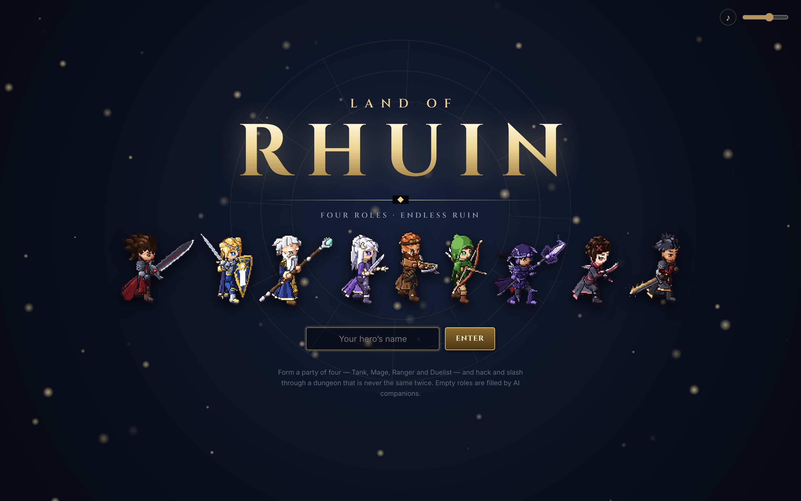
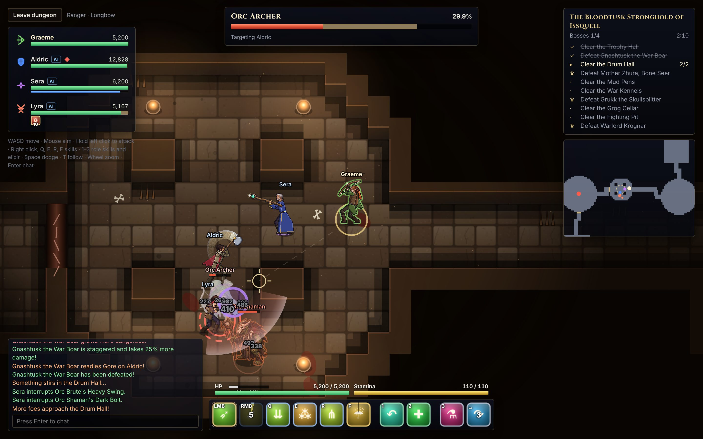
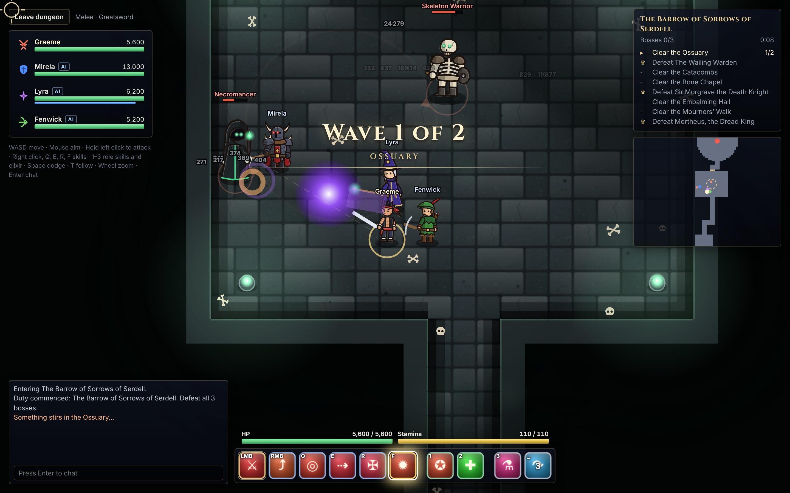
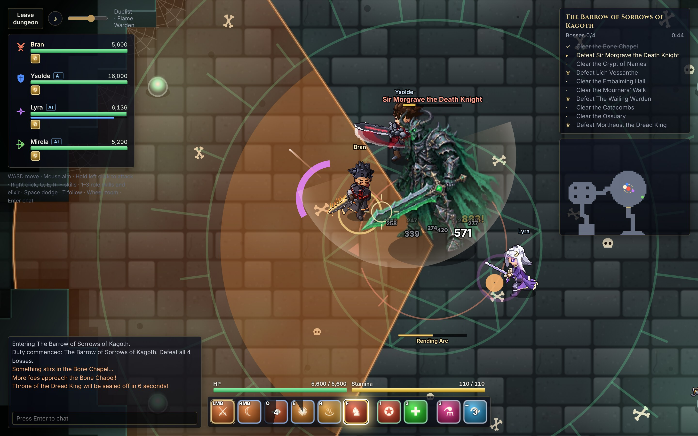
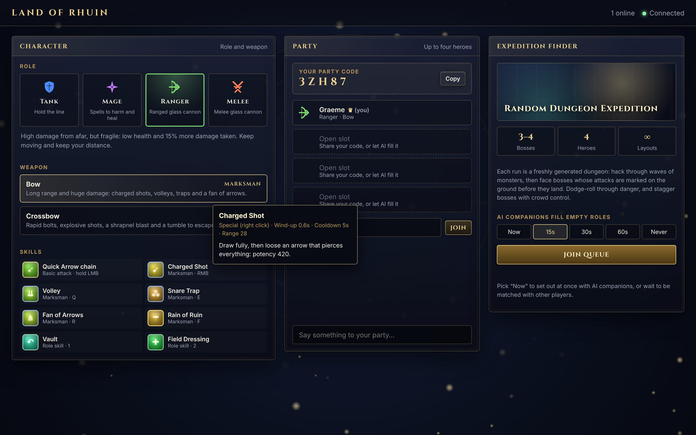

# Land of Rhuin

A four-player co-op hack-and-slash dungeon RPG that runs in the browser. Form a party of four (Tank,
Mage, Ranger and Melee) and carve through a dungeon generated fresh for every run. Every dungeon
belongs to one of three monster clans: **Orcs**, **Dragons and their cultists**, or the **Undead**.
Each run has waves of monsters, then 3 or 4 bosses whose attacks are marked on the ground before
they land. Players queue together or alone, and AI companions fill any role nobody is playing.

Combat is aimed and hands-on. Hold the mouse to swing your weapon's combo, fire skills toward the
cursor, and dodge-roll through danger. The dungeon structure takes its cues from big fantasy MMO
dungeons: a finder queue with a ready check, enmity and taunts, sealed boss arenas, and orange
telegraphs to step out of. All names, art, skills and bosses are original.




## Quick start

You need Node.js 20.19 or later.

```sh
npm ci
npm run build
npm start            # http://127.0.0.1:8787
```

Open the address, pick a name, choose a role and weapon, set **AI companions fill empty roles**
to **Now**, and press **Join Queue**. Accept the ready check with **Commence**.

To play with friends on your network, start the server with `npm start -- --host 0.0.0.0` and
have them open `http://<your-ip>:8787`. One player shares their **party code**; the others type
it into **Party code** and press **Join**. The party leader then joins the queue.

| Server option | Effect |
| --- | --- |
| `--port 8787` | Port for the web page and the game socket. |
| `--host 127.0.0.1` | Interface to listen on. Use `0.0.0.0` for LAN play. |
| `--quick` | Monsters have a quarter of their health. Good for trying things out. |
| `--countdown 5` | Seconds before the entrance barrier drops. |
| `--clan orc` | Make every dungeon belong to one clan: `orc`, `dragon` or `undead`. |

For development, `npm run dev` runs the server with reload on port 8787 and the Vite client on
http://localhost:5173 (it forwards the game socket to the server).

## Controls

| Input | Action |
| --- | --- |
| W A S D | Move |
| Mouse | Aim. Your hero always faces the cursor. |
| Hold left mouse | Basic attack: your weapon's three-hit combo |
| Right mouse | Weapon special |
| Q, E, R | Weapon skills |
| F | Weapon ultimate |
| 1, 2 | Role skills |
| 3 | Elixir (restores 35% HP) |
| Space | Dodge roll: a short roll during which nothing can hurt you. Costs stamina. |
| T | Follow the tank, or the party member you selected |
| Tab, F1 – F4 | Select an enemy or a party member to see them in the target frame |
| Mouse wheel | Zoom |
| Enter | Chat |

Every skill is aimed at the cursor:

- **Arcs and thrusts** hit everything in front of you.
- **Projectiles** fly until they hit something; some pierce or explode.
- **Ground skills** land where you point, some after a short delay, shown as a blue marker.
- **Dashes and leaps** carry you through or onto your enemies.

A few heavy skills have a short wind-up; moving or rolling cancels it.

## Roles and weapons

| Role | Strengths | Weapons |
| --- | --- | --- |
| **Tank** | The most health and stamina, crowd control and taunts. *Rallying Bulwark* gives the whole party 20% damage reduction and a barrier. | Greatsword, Battleaxe, Sword & Shield |
| **Mage** | Offensive and healing spells. | Staff, Mystic Sword |
| **Ranger** | High damage from range. A glass cannon: low health, 15% more damage taken. | Bow, Crossbow |
| **Melee** | The highest damage in the party, and the easiest to fall: low health, 20% more damage taken. | Spear, Lance, Greatsword |

| Weapon | Style | Special (RMB) · Q · E · R · Ultimate (F) |
| --- | --- | --- |
| Greatsword (Tank) | Warden | Parry · Upheaval (line stun) · Gravity Sweep (pulls enemies in) · Earthsplitter · Titan's Verdict (leap and stun) |
| Battleaxe | Berserker | Iron Hide (damage heals you) · Cleaving Spin · Hurl Axe (stun) · War Stomp · Bloodstorm |
| Sword & Shield | Guardian | Shield Block · Shield Bash (stun) · Rally Charge · Shield Throw · Bastion |
| Staff | Sage (healer) | Mending Light (heal circle) · Arcane Orb · Sanctuary (healing ground) · Meteor · Resurrection |
| Mystic Sword | Spellblade | Runic Ward (barriers) · Spellblade Rush · Arc Lightning · Lifebinding Sigil (damage and heal) · Astral Cleave |
| Bow | Marksman | Charged Shot · Volley · Snare Trap · Fan of Arrows · Rain of Ruin |
| Crossbow | Arbalist | Piercing Bolt · Explosive Bolt · Tumble Shot · Scattershot · Siege Barrage |
| Spear | Lancer | Sweeping Strike · Piercing Thrust · Vault Strike · Whirling Spear · Skewer |
| Lance | Cavalier | Brace · Lance Charge · Impaling Drive · Skybreaker · Valiant Onslaught |
| Greatsword (Melee) | Reaver | Rising Slash · Whirlwind · Reaver's Lunge · Executioner · Cataclysm Blade |

Role skills: the Tank has **Challenge** (taunt everything nearby) and **Rallying Bulwark**. The
Mage has **Arcane Blink** and **Mana Font**. The Ranger has **Vault** and **Field Dressing**. The
Melee has **Bloodrush** (more damage dealt, more taken) and **Second Wind**.

The Staff is the party's healer. AI companions filling the Mage slot always bring it. A party
without a Staff gets the *Ward of Rhuin*: 15% less damage taken and a slow heal in combat.

In AI-only test runs, Melee deals about 1,500 damage per second, Rangers about 1,150, Mages
about 750 to 800 and Tanks about 500.

## Heroes and clans

Every hero comes in a male and a female version; pick one under *Appearance* in the lobby, and
your party sees it in the dungeon. The Tank is an armoured warrior in steel plate and a crimson
cape, the Mage a silver-haired spellcaster in embroidered robes, the Ranger a cloaked archer with
a quiver, and the Melee a lightly armoured duelist with a red scarf. Weapons are separate pixel
sprites: heroes hold theirs toward your aim and swing it when they attack, and the Sword & Shield
tank carries a heater shield. Characters bob as they walk, lean into their strikes, flash when
hit, and fall when knocked out.


Each dungeon is the lair of one clan, with its own monsters, bosses, rooms, colours and floor:

| Clan | Dungeon | Monsters | Bosses |
| --- | --- | --- | --- |
| **Orcs** | The Bloodtusk Stronghold: torchlit earth, bones, blood and stakes | Orc Brute, Goblin Cutthroat, Orc Archer, Orc Shaman, Orc Ravager, War Totem | Grukk the Skullsplitter, Mother Zhura the Bone Seer, Gnashtusk the War Boar, Old Ironjaw the Ogre, and Warlord Krognar |
| **Dragons** | The Cinder Sanctum: obsidian, glowing lava cracks and drifting embers | Drakonid Warrior, Wyrmling, Cult Crossbowman, Flamecaller Cultist, Fire Drake, Dragon Idol | Scalebreaker Vorth, High Priestess Seraphine, Ashwing the Wyvern, the Obsidian Guardian, and Ignaroth the Elder Flame |
| **Undead** | The Barrow of Sorrows: cold stone, graves, cobwebs and green mist | Skeleton Warrior, Ghoul, Skeleton Archer, Necromancer, Bone Abomination, Cursed Obelisk | Sir Morgrave the Death Knight, Lich Vessanthe, Grimmaw the Bone Hound, the Wailing Warden, and Mortheus the Dread King |


| Orcs | Dragons | Undead |
| --- | --- | --- |
|  |  |  |
|  |  |  |

The heroes, monsters and bosses use transparent pixel sprite assets in `src/client/art/creatures/`.
Each sprite has a ground anchor and a display height, and heroes also have a grip point for
their separately rendered weapons. Weapons and the Guardian's shield use matching transparent pixel sprites in
`src/client/art/equipment/`, with grip points for aiming and attack animations.

## How a run works

1. **Lobby.** Choose a role, an appearance, and one of its weapons. Hover a skill to read what it does.

   

2. **Party.** Everyone starts in their own party with a 5-letter code. Up to four players can
   join one party, and each member needs a different role to queue.
3. **Queue.** The leader picks when AI companions fill empty roles: now, after 15, 30 or 60
   seconds, or never. The matchmaker merges parties whose roles do not overlap. A full party of
   four starts at once.
4. **Ready check.** Everyone in the group has 30 seconds to press **Commence**. If someone
   withdraws, the others go back to the queue at their original place.

   

5. **The dungeon.** A chain of rooms joined by corridors. In front of each boss are one or two
   rooms you clear in 2 or 3 waves; barrier gates open as you clear them. When the tank is an AI
   companion, it leads the party between fights and waits for the players. A boss arena seals six
   seconds after the fight starts, and the last boss always has three phases.
6. **Stagger.** Stuns, knockbacks, pulls and heavy blows fill a boss's stagger bar. When it is
   full the boss is staggered: helpless for 4 seconds and taking 25% more damage.
7. **Wipes.** If the whole party falls, everyone returns to the last checkpoint and the encounter
   resets. Each wipe adds a stack of *Echo of Rhuin* (up to 3): 10% more damage dealt and 10%
   less damage taken per stack.
8. **Results.** When the final boss falls you get the clear time and each hero's damage,
   healing and knockouts.

Monsters wind up their attacks too. Brutes flash a short red arc before they swing, and archers
and casters draw an aim line before they shoot. Step aside or roll through.

## Reading boss mechanics

| Marker | Meaning |
| --- | --- |
| Orange area filling up | Damage lands when it fills. Get out, or roll through at the last moment. |
| Faint red arc or line | A monster's routine swing or shot. Dodge it if you can. |
| Gold circle with arrows pointing in | **Stack**: the damage is shared by everyone inside. Stand together. |
| Purple circle on each player | **Spread**: each circle also hits anyone else inside it. Spread out. |
| Red circle and diamond over a head | **Tank buster**: a heavy hit on the target. Tank: block or parry. Everyone else: stay clear. |
| Blue arrows around the boss | **Knockback**: everyone is thrown away from the boss. |
| Red screen edges | **Raid-wide** damage is about to hit everyone. |
| Blue dashed circle | Your party's own delayed blast (Meteor, Volley, Rain of Ruin). |

Getting hit by an avoidable attack adds *Vulnerability Up*: 25% more damage taken per stack for
10 seconds.

## How it is built

```
src/shared/      Rules both sides use: constants, geometry, the tile map with collision, line of
                 sight and A* pathfinding, the network protocol, and the content (roles, weapons,
                 skills, statuses, monsters, bosses, clans).
src/server/      Node.js server.
  dungeonGen.ts  Seeded dungeon generator.
  sim/           The dungeon simulation: instance (rooms, waves, gates, wipes), combat (aimed
                 skills, damage, healing, statuses, stagger), projectiles, mechanics (telegraphs
                 and bosses), monster AI.
  ai/botAI.ts    AI companions: targeting, positioning, dodging and rolling, stack and spread,
                 healing, raising, taunting, staggering, leading the party.
  matchmaker.ts  Role-unique queue with AI fill.
  lobby.ts       Players, parties, queue, ready checks, instances, reconnects.
  main.ts        HTTP server for the client and the WebSocket at /ws.
src/client/      Browser client (TypeScript and canvas, no framework).
  ui/            Title screen and lobby.
  art/           Sprite art: the pixel kit and pixel heroes and weapons, the SVG kit and the
                 clans' monsters and bosses.
  game/          World state, renderer, HUD, effects, input and prediction.
test/            Unit tests and full dungeon runs.
e2e/             Browser test with two players.
```

- **Server-authoritative.** The server simulates every dungeon at 20 ticks per second and sends
  each player a snapshot 10 times a second. It decides every hit, heal, cooldown, projectile and
  AI action.
- **Responsive movement.** Your own character moves and rolls immediately on your screen, using
  the same collision code as the server, which checks every move against your speed. When the
  server moves you itself (dashes, leaps, knockbacks), the client eases you to the new position.
  Everyone else is drawn slightly in the past and interpolated between snapshots, and projectiles
  are extrapolated along their flight.
- **Reproducible dungeons.** A dungeon is generated from a seed, so the same seed gives the same
  layout, rooms, waves and bosses.
- **Reconnects.** The browser keeps a token. If you drop out of a dungeon, an AI companion plays
  your character until you reconnect, then hands it back.

## Tests

```sh
npm test            # unit tests, plus complete dungeon runs by AI-only parties
npm run typecheck
npm run e2e         # builds, then drives two browsers through a party, queue and first room
npm run simulate -- 42 5   # play 5 dungeons (seeds 42-46) with AI parties and print results
```

The simulation tests have four AI parties with different weapons clear entire dungeons. That
checks the generator, the combat rules, every boss and the AI together, and keeps the balance
honest: AI parties clear a dungeon in about 8 to 11 minutes.

## Ideas for what is next

- Gear and rewards from bosses, and character progression between runs.
- Accounts and saved characters (players are currently kept in memory by the server).
- Sound and music, and frame-by-frame animation for the sprites.
- Gamepad support.
- More clans, bosses and mechanics (towers to soak, tethers, line stacks, gaze attacks).
- A harder difficulty and a timed leaderboard.
- Rate limiting and stricter validation before running a public server.
